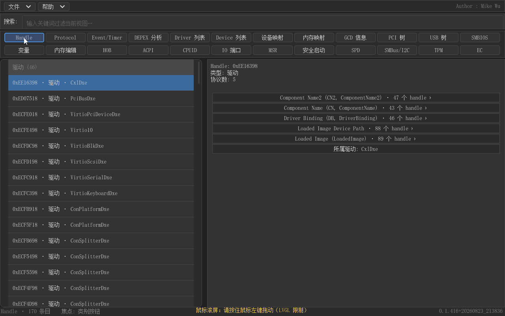
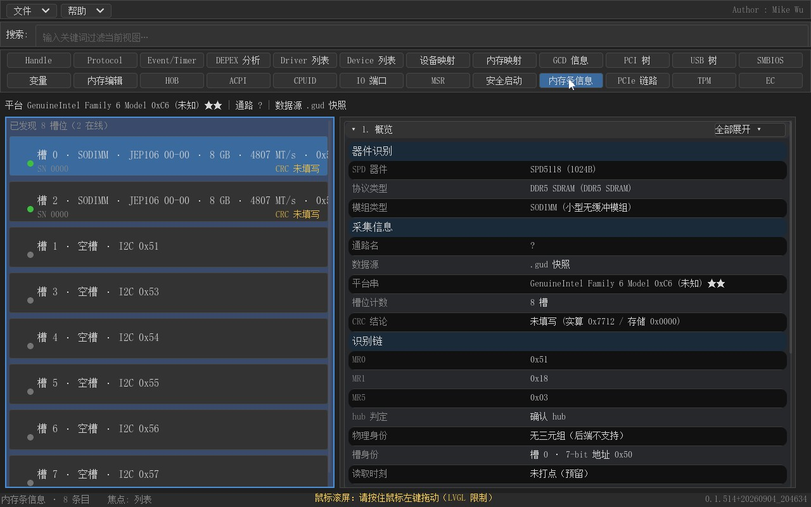
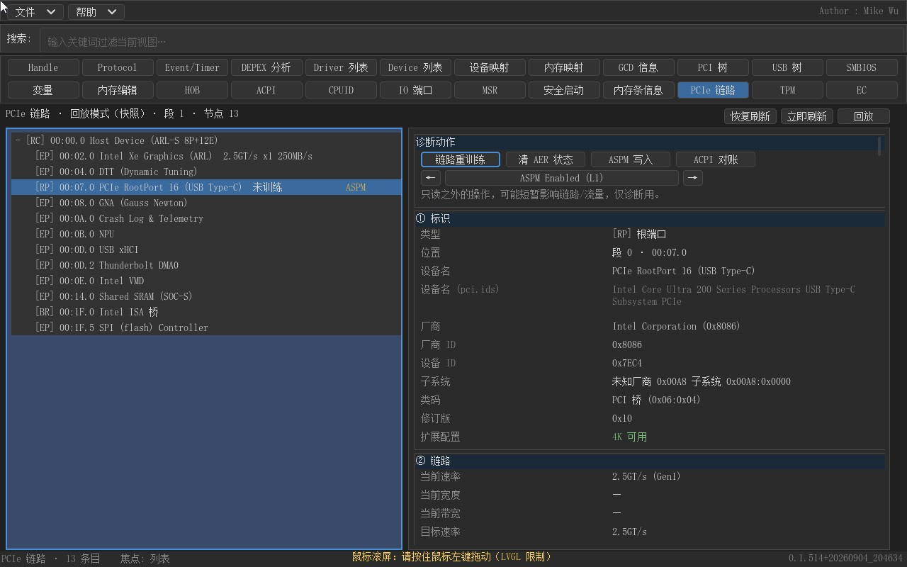

# gudumpinfo — Graphic UEFI System Info Viewer

> [English version below](#english) ｜ [English README](#english)

> **版本 0.1.514（2026-09-05）** ｜ [Latest Release](https://github.com/MikeWuPing/gudumpinfo/releases)

gudumpinfo 是一个图形化系统信息查看器：它直接运行在 **UEFI 固件环境**里（无需操作系统），全简体中文界面（内置中文字库）、鼠标与键盘双输入，把 UEFI 开发与排障所需的底层信息聚合为 22 个可点击的视图——定位上相当于"固件世界的系统信息工具"，但它会用 **SDM/EDK2/EDS 级的深度**把每个字段解释给你看。

> 在固件世界，想看一眼 CPU 到底是什么、ACPI 表里写了什么，不该只能敲命令。

- **作者**：Mike Wu ｜ **许可证**：[MIT](LICENSE)
- **界面语言**：简体中文（SimSun 中文字体内置）
- **产品手册**：[功能演示 GIF](docs/manual/gudumpinfo-overview.gif) ｜ [说明书（简版）](docs/manual/gudumpinfo-说明书-简版.md) ｜ [说明书（详版）](docs/manual/gudumpinfo-说明书-详版.md)

## 两种运行方式

**方式 A：Live CD（推荐，无需 UEFI Shell、无需操作系统）**——本仓库根目录的 `gudumpinfo-boot-0.1.514.iso` 就是现成的启动镜像：

1. 把 ISO 内容拷到 FAT32 U 盘根目录（含 EFI 目录），或直接刻录/挂载该 ISO；
2. 在固件设置里把启动介质选为 UEFI 模式（不要选 Legacy/CSM）；
3. 固件 Boot Manager 会直接从 `EFI\BOOT\BOOTX64.EFI`（X64）或 `BOOTAA64.EFI`（ARM64）加载 gudumpinfo——**没有 Shell、没有系统也直接进主界面**。

> Secure Boot 开启时未签名镜像会被拒：请先到固件设置（Security/Boot 页）关闭 Secure Boot，用后建议恢复。ISO 为 ISO9660 + UDF + El Torito EFI 混合格式，OVMF 与真实固件均可启动。

**方式 B：有 Shell / 有固件引导环境**——把对应架构的 `GudumpInfo.efi` 拷到 FAT 介质，UEFI Shell 中执行 `GudumpInfo.efi`（或放入 `EFI\BOOT\` 配合 `startup.nsh` 自动启动）。

**两种方式下**：主界面点击左侧 22 个功能按钮查看；全局搜索框（Ctrl+F）即时过滤；Ctrl+S 保存当前视图为 `.gud` 快照、Ctrl+L 载入（真机现场可离线回放）；Ctrl+Q 退出。

## 功能一览（22 个信息视图 + 2 个开发中占位）

Handle/Protocol（590+ 条可读协议名 + 反查）、协议中心、设备/驱动/映射（设备实例名）、内存映射、GCD、PCI 树、USB 树、SMBIOS、变量、内存编辑、HOB、ACPI（24 张表逐字段解析 + DSDT/SSDT 反编译成 ASL、ASL↔HEX 联动、校验和自动重算）、CPUID（41 leaf/2470 位域逐项解析 + 当前值括注 + 平台识别）、IO 端口（三级写保护）、MSR（1359 条知识表 + MTRR 解析 + 全核批量读）、Secure Boot（证书库 X509 + SHA256 指纹）、Event/Timer（IEVENT 扫描 + 自校准）、DEPEX 分析（驱动依赖表达式全量对账 + 最小致缺）、**内存条信息（SPD）**、**PCIe 链路**。

- **内存条信息（SPD）**：DDR5 内存侧带诊断——SPD5 Hub（SPD5118）识别链与 CRC 结论、制造/时序/颗粒、PMIC/RCD/TS **小料 MR 寄存器**逐字段解析、写保护位图、SPD↔SMBIOS Type17 逐槽对账；数据通路自动判定（标准 SMBus 直读 / CPU I3C 私有协议 / CPU 侧带 CSR / BDAT MRC 快照 / SMBIOS 摘要降级——ARM 上正确降级提示）。
- **PCIe 链路**：桥可达 BFS 拓扑树（RC→RootPort→Switch→EP，多根桥/多 socket 分段），**EDS 精确设备名** + pci.ids 兜底；链路协商速率/宽度/带宽、ASPM/AER/ECap（RBAR/DPC/L1SS…）字段级解码、AER 软件累计错误计数；诊断写（链路重训练/AER 清位/ASPM 切换，确认框）；DSDT `_ADR` 对账。
- **数据快照**：除 IO 端口外全部视图可 `Ctrl+S` 存为 `.gud`、`Ctrl+L` 离线回放（零总线读）。

- **架构**：一套源码双架构（X64 / AARCH64）；AARCH64 上 CPUID/IO 端口/MSR 三个 x86 专属视图自动灰调，其余视图完全一致。

## 已知限制

- 内存编辑/IO 端口/MSR 写入受三级保护（确认/二次确认/拒绝）；ACPI 修改为会话级（重启恢复）。
- Live CD 镜像未签名，Secure Boot 需关闭；需固件能读到 FAT/ISO9660/UDF 介质（现代固件均可）。
- SPD 深度功能（小料 MR）为 x86/特定平台专属；ARM 上自动显示 SMBIOS 摘要。

## 许可证

MIT License。参见 [LICENSE](LICENSE)。

---

## 兄弟项目

- [gsetupmod](https://github.com/MikeWuPing/gsetupmod) —— 固件设置浏览器：解析 HII/IFR 重建 BIOS Setup，展示被固件隐藏的选项
- [UEFI_Test_Suite](https://github.com/MikeWuPing/UEFI_Test_Suite) —— UEFI 硬件诊断工具套件
- [pcDig](https://github.com/MikeWuPing/UEFI_Test_Suite/tree/main/pcDig) —— UEFI 整机硬件诊断：21 项自检（CPU/内存/存储/显存/网络/USB/输入设备/启动诊断/事件日志），免 Shell 可启动 ISO
- [guedit](https://github.com/MikeWuPing/guedit) —— UEFI Shell 下的图形化文本编辑器（LVGL）
- [gufile](https://github.com/MikeWuPing/gufile) —— UEFI Shell 下的 GUI 文件管理器（Explorer 式界面）
- [mount](https://github.com/MikeWuPing/mount) —— UEFI Shell 挂载工具：NTFS/ext4/ISO 卷挂载与 ISO 虚拟块设备

---

## English

# gudumpinfo — Graphic UEFI System Info Viewer

**Version 0.1.514 (2026-09-05)** ｜ [Latest Release](https://github.com/MikeWuPing/gudumpinfo/releases)

A GUI system-information viewer that runs directly in the **UEFI firmware environment** (no OS below it), with a fully simplified-Chinese UI (built-in SimSun CJK font), mouse & keyboard input, and 22 clickable views that explain every field at SDM/EDK2/EDS depth.

## Two ways to run

**A) Live CD (recommended — no Shell, no OS)** — `gudumpinfo-boot-0.1.514.iso` in this repo is a ready boot image:

1. Copy the ISO contents to the root of a FAT32 USB stick (keep the `EFI` directory), or burn/mount the ISO;
2. Set the firmware to boot UEFI mode (not Legacy/CSM);
3. The firmware Boot Manager loads `EFI\BOOT\BOOTX64.EFI` (or `BOOTAA64.EFI` on ARM) directly — **you land in the gudumpinfo main window with no Shell and no OS**.

> Secure Boot must be off (unsigned image; re-enable afterwards). The ISO uses ISO9660 + UDF + El Torito EFI hybrid, bootable on OVMF and real firmware alike.

**B) Shell / custom boot** — copy the arch-appropriate `GudumpInfo.efi` to a FAT medium and run it from the UEFI Shell (or drop it in `EFI\BOOT\` with a `startup.nsh`).

In both modes: click the 22 buttons on the left; Ctrl+F filters; Ctrl+S saves the current view as a `.gud` snapshot and Ctrl+L loads it (offline replay of a real-machine scene); Ctrl+Q quits.

## Features (22 views + 2 upcoming placeholders)

Handles/Protocols (590+ readable names + reverse lookup), protocols center, devices/drivers/mappings, memory map, GCD, PCI tree, USB tree, SMBIOS, variables, memory editor, HOB, ACPI (24 tables decoded + DSDT/SSDT disassembly with ASL↔HEX linking and automatic checksum), CPUID (41 leaves / 2470 bit fields with current-value suffix + platform recognition), IO ports (three-tier write protection), MSR (1359-entry knowledge table + MTRR + all-core batch read), Secure Boot (X509 + SHA256 fingerprints), Event/Timer (IEVENT scan + self-calibration), DEPEX analysis (dependency-expression reconciliation + minimal-missing hint), **Memory Info (SPD)** and **PCIe Link** — the latter two decode DDR5 sideband (SPD5 Hub/PMIC/TS MR registers, CRC & SMBIOS reconciliation) and PCIe topology/link state (bridge-reachability BFS tree, exact EDS names, ASPM/AER/ECap decoding, diagnostic writes, DSDT `_ADR` reconciliation) respectively. Every view except IO ports saves/loads `.gud` snapshots for offline replay.

**Architecture**: one source tree, X64 & AARCH64; the x86-only views CPUID/IO ports/MSR gray out automatically on AARCH64, everything else works identically.

## Sister Projects

The developer's other UEFI series tools:

- [gsetupmod](https://github.com/MikeWuPing/gsetupmod) — Firmware settings browser: rebuild BIOS Setup by parsing HII/IFR, exposing hidden options
- [UEFI_Test_Suite](https://github.com/MikeWuPing/UEFI_Test_Suite) —— UEFI hardware diagnostics, testing and repair-assist tools
- [pcDig](https://github.com/MikeWuPing/UEFI_Test_Suite/tree/main/pcDig) — UEFI whole-machine diagnostics: 21 self-test checks, shell-free bootable ISO
- [guedit](https://github.com/MikeWuPing/guedit) — GUI text editor for UEFI Shell (LVGL)
- [gufile](https://github.com/MikeWuPing/gufile) — GUI file manager for UEFI Shell (Explorer-style)
- [mount](https://github.com/MikeWuPing/mount) — UEFI Shell mount tool: NTFS/ext4/ISO volume mounting and ISO virtual block devices

## License

MIT License. See [LICENSE](LICENSE).
