# gudumpinfo — Graphic UEFI System Info Viewer

> [English version below](#english) ｜ [English README](#english)

> **版本 0.1.551（2026-09-15）** ｜ [Latest Release](https://github.com/MikeWuPing/gudumpinfo/releases)

gudumpinfo 是一个运行在 **UEFI Shell** 中的图形化系统信息查看器，定位类似 Windows 下的系统信息工具，但运行在固件环境里——不依赖任何操作系统。它基于 LVGL 图形库构建，**全简体中文界面**（内置中文字库），鼠标与键盘双输入，覆盖 UEFI 开发者日常排障所需的全部底层信息：Handle/Protocol、设备、驱动、映射、内存映射、GCD、PCI 树、USB 树、SMBIOS、变量、HOB、ACPI 表，以及深度解析的 **CPUID**，并新增 **DEPEX 分析**（DXE 驱动依赖表达式枚举求值——未调度驱动一网打尽：缺哪个协议、最小致缺、句柄跳转）。**支持 X64 与 AArch64 双架构**（一套源码；AArch64 上 x86 专属视图 CPUID/IO 端口/MSR 自动灰调，其余一致可用，见「构建」节）。

> 在固件世界，想看一眼 CPU 到底是什么、ACPI 表里写了什么，不该只能敲命令。


- **作者**：Mike Wu
- **许可证**：MIT
- **图形库**：[LVGL 9.2.2](https://lvgl.io)（独立开源，见下方依赖）
- **界面语言**：简体中文（SimSun 中文字体内置）
- **产品手册**：[功能演示 GIF](docs/manual/gudumpinfo-overview.gif) ｜ [说明书（简版）](docs/manual/gudumpinfo-说明书-简版.md) ｜ [说明书（详版）](docs/manual/gudumpinfo-说明书-详版.md)

---

## 目录

- [功能特性](#功能特性)
- [界面一览](#界面一览)
- [产品手册](#产品手册)
- [依赖](#依赖)
- [目录结构](#目录结构)
- [运行](#运行)
- [截图展示](#截图展示)
- [已知限制](#已知限制)
- [许可证](#许可证)

## 功能特性

- **22 个信息视图 + 2 个开发中占位**（主界面按钮导航，按钮栏 12 列，两行 24 个按钮排布；TPM/EC 为即将推出的功能占位，点击提示"开发中"；SPD 占位已实现为「内存条信息」、SMBus-I2C 占位由「PCIe 链路」承担；DEPEX 分析紧随 Event/Timer 之后）：
  - **Handle/Protocol**：handle → 挂载的 protocol（**590+ 条可读名表**：edk2 全包 + gEdkii + MTL 平台协议，附**常用缩写别名**如 Graphics Output (GOP)；协议行显示**安装计数**「· N 个 handle」，点击反向查询）→ DevicePath
  - **协议（M16）**：系统**全部已安装协议**中心——左协议清单（名字 + 别名 + 安装数，可搜索）→ 右安装它的 handle 列表 → 点击跳回 Handle 视图定位；支持 .gud 保存/载入
  - **设备列表 / 驱动列表 / 设备映射**：设备路径、**设备实例名**（ComponentName2 尽力而为，如 "QEMU Video PCI Adapter"）、驱动绑定关系；**驱动列表两组**（组头双击折叠）——"Drivers（同 `drivers` 命令·有 Binding 协议）"与"补充（已加载·无 Binding 协议，如 CpuDxe 架构驱动）"，驱动名优先 ComponentName2、回退 FFS 模块名；fs0:/blk0: 映射与卷标
  - **内存映射**：GetMemoryMap 描述符，按类型分类/平铺两种视图
  - **GCD**：内存空间 + IO 空间双表，按分类/平铺 + 子页签
  - **PCI 树 / USB 树**：全扫描设备树，配置空间十六进制查看，Enter 跳转对应 Handle
  - **SMBIOS**：Type 0/1/2/3/4… 逐字段中文解读
  - **变量**：GetNextVariableName 枚举，按属性（NV/RT/volatile）分组
  - **内存编辑 / HOB**：十六进制编辑器（UEFI 内存直读直写），HOB 列表 + 编辑
  - **ACPI**：全部 ACPI 表按分类列出，普通表逐字段解析（FADT/MADT/FACS…），**AML 表（DSDT/SSDT）反编译成 ASL**，ASL↔HEX 双向联动（点 ASL 行高亮对应字节区间），HEX 可编辑、**校验和自动重算**
  - **CPUID**：全量 leaf 采集（标准 0x00-0x2F + 扩展 0x80000000-0x26），**表格化逐位域解析**——每行 `位域 | Bits | 值 | 结论 | 说明`，1-bit 特性位显示明确的 **支持/不支持** 结论防误读；**说明列括注当前值**（枚举中文名/十进制，如 `（当前: 8）`，M16）；41 个 leaf 定义、2470 个位域、577 条中文解释（含 Key Locker/PCONFIG/LBR/AMX/TMUL/SGX/ArchPerfmon 及 AMD Zen4/Zen5 全系，均自 Intel SDM / AMD APM 查证）；**平台识别**（Meteor Lake/Arrow Lake/Panther Lake 等型号表自官方 EDS）；清单三组（标准/扩展/**未定义**）可折叠
  - **IO 端口**：x86 IO 空间（0x0000-0xFFFF）**Byte/Word/DWord 三种宽度读写**——窗口式浏览（256 端口/窗，翻窗不自动读）、内置**常用端口注解表**（约 60 端口：DMA/PIC/PIT/键盘/CMOS/POST/串并口/ATA/VGA/PCI 配置等，危险端口红/橙标记）；**强写保护**：进入零读取、一切访问显式触发；写操作三级管控——普通端口一次确认、**危险端口**（PIC/PIT/DMA/CMOS/PCI 配置 0xCF8/0xCFC 等）**二次确认**、**致命端口**（复位 0xCF9/0x92、CMOS 索引 0x70、键盘命令 0x64、SuperIO 索引）**直接拒绝**；宽度对齐硬规则（奇数端口仅 Byte）；副作用读端口（0x60/0x64）警告条提示；PCI 配置空间读取（0xCF8 写地址 + 0xCFC 读数据）
  - **MSR**：x86 模型特定寄存器**读写**——左侧分组 MSR 清单（**1359 条自动生成知识表**：MdePkg 架构 MSR 358 + MTL 平台特有 1001，含地址/名称/位域/只读标志，按组折叠），右侧 **64 位值 + 逐位域解析表**（位范围/字段名/值/说明），**MTRR 专门解析**（PHYSBASE/PHYSMASK 配对算内存区间：从哪到哪、大小、UC/WC/WT/WP/WB 类型；固定范围段摘要；DEF_TYPE 默认类型 + FE/E 启用位）；顶部 CPU 摘要条（型号/微码/缓存/核心线程/频率/温度）；**核选择 + 全核批量读**（MP Services 逐核执行）；**写入三级保护**（致命置灰/危险二次确认/普通一次确认，默认禁写需 ⚙ 设置开启）；**危险读拦截**（APIC/X2APIC 读取会死机的寄存器红字警示且不执行读取）；可选 **#GP 安全读钩子**（EFI_CPU_ARCH_PROTOCOL，默认关）
  - **Event/Timer**：**全系统事件与定时器扫描**——内存扫描 EDK2 `IEVENT` 事件对象（'evnt' 签名 + 多层结构校验 + 自校准验证固件兼容性），左侧分组列表 **Event**（组事件/协议通知事件，组头显示计数可折叠）/ **Timer**（周期定时器，显示周期估算与挂载状态），行内**箭头语义**：`事件组名 → 回调模块!偏移`（如 `ExitBootServices → DxeCore!+0x…`）、挂载协议事件显示协议名、纯自定义信号事件标注"自定义信号"、行尾触发计数 ×N；状态栏统计 `有 hook K · 纯回调 P`（hook=可追溯到事件组/协议名）；右侧逐字段详情（事件类型位解读、通知级别、通知函数地址与**所属模块名**、事件组 GUID、触发计数、ExFlag、Timer 周期/下次触发）；详情下方**「查看句柄」链接一键跳转 Handle 视图**；全局搜索**大小写不敏感模糊匹配**（搜 "exit" 命中 ExitBootServices 组事件）；.gud 保存/载入（168 字节定长条目）
  - **DEPEX 分析（新增）**：**DXE 驱动依赖表达式全量对账**——扫描固件存储（FFS，含嵌套 FV）全部驱动文件的依赖表达式（depex 字节码，EDK2 PHIT 编码），与系统实际挂载/调度状态逐一对账：左侧按原因分组（**缺依赖**——行内"驱动名 缺 <协议名>，依赖无法满足"、恒 FALSE、加载失败疑点、其他类型（PEIM/SMM/嵌套卷与无法分析项各注明中文原因）、已调度），组头**双击折叠**；每组行首箭头语义（组名/协议名 → 回调模块!偏移），触发计数 ×N；详情给出**依赖表达式可读化**（协议名标注已装/缺失）与**最小致缺**结论（缺哪一个协议即修、或缺的组合），未知协议显示 GUID 并标注；同名多份镜像标注"·N 份"（如 CpuDxe 双份：TDX 门槛版 vs 运行版）；**句柄跳转**；过滤走全局搜索框
  - **内存条信息（SPD，新增）**：DDR5 内存侧带诊断——左槽位列表（绿点/DIMM 类型/厂商/容量/速率/SN）→ 右 11 分区折叠面板：SPD5 Hub（SPD5118，1024B NVM）识别链（MR0/1/5 与 hub 判定）、CRC 结论（stored vs 实算，不符标红）、制造/时序/颗粒（NVM ASCII、厂商日期、CL/RCD/RP…、颗粒组织与位宽）、**小料与写保护**（PMIC/RCD/TS 的 MR 寄存器分区——判型·厂商·修订头部 + 电压/温度/状态位全字段按 JEDEC 解析；写保护位图 16 块锁定位标红）、**对账**（SPD ↔ SMBIOS Type17 逐槽交叉，不一致红字）；**数据通路自动判定**（标准 SMBus 直读 / CPU I3C 私有协议 / CPU 侧带 CSR 三源 / BDAT MRC 快照 / SMBIOS 摘要降级——ARM 上正确降级并提示深度功能 x86 专属）；SPD 段 .gud 快照回放
  - **PCIe 链路（新增）**：RW Everything 式 PCIe 拓扑与链路诊断——**桥可达 BFS 拓扑树**（自每根桥 RC 出发，Type1 Sec/Sub 递归，只扫有设备的总线；多根桥/多 socket 分段），节点行 = **EDS 精确设备名**（GNR/ARL/PCH 官方 Device Mapping 148 条）/pci.ids 名兜底（5542 条全量 Intel 表）/未知退 hex + BDF + 类码 + 协商速率×宽度 + 带宽 + ASPM/AER 徽章；详情区全字段：**链路**（当前/目标/最大速率与带宽，Gen1-6 换算含 FLIT）、**ASPM**（支持/启用/当前三层 + L1.1/L1.2）、**AER**（UC/C 状态位图、掩码、严重度、Header Log、软件累计错误计数）、**ECap**（RBAR/DPC/L1SS/VC/ACS/PTM 分组全字段）、Capability 全量、Raw 16B/行；**诊断写**（链路重训练 / AER 状态清位 / ASPM 切换——确认对话框 + 写后读回校验）；**ACPI 对账**（DSDT `_ADR` 设备数 vs 扫描树，手动触发 + 进度条）；PCIP 段 .gud 快照回放
  - **Secure Boot**：安全启动状态与证书库**只读**查看——顶部**摘要条**（Secure Boot 启用/禁用徽标 + **派生模式**：设置/用户/部署/审计（SetupMode/DeployedMode/AuditMode 规范状态机推导）+ 签名类型数 + 认证变量数，第二行各库 `类型:数量` 一览，点击"签名类型:N"弹详情）；左列表**六个标准签名库**（PK/KEK/db/dbx/dbt/dbr）+ Default 系列（PKDefault/KEKDefault/dbDefault/dbxDefault）+ **全部认证变量**（EFI_VARIABLE_AUTHENTICATED_ACCESS_ACCESS 属性的第三方变量，如 shim 的 MokList，按名称排序、上限 64）；右表格条目列（序号/签名类型/主题 CN 或哈希摘要/大小），选中条目**X509 证书详细解析**（手写轻量 DER：subject/issuer 的 CN/O/C/OU、序列号、有效期、公钥算法与位数、**SHA256 指纹**），SHA256 哈希类签名显示完整 32 字节；库缺失显示"（不存在）"灰字、签名列表越界显示"（解析失败）"红字且不影响其他库；Tab 左库/右条目双焦点区、Ctrl+F 搜索库名；数据源全部为 UEFI 变量（SecureBoot/SetupMode/PK/KEK/db/dbx 等），不含 enroll/写入操作
  - **Save As / Load From File（M15）**：文件菜单"**保存当前视图为文件…**"（Ctrl+S）/ "**从文件载入…**"（Ctrl+L）——把任意视图采集的原始数据保存为 `.gud` 文件（弹窗选卷 + 推荐文件名 `gud_<功能>_<时间戳>.gud`），可在另一台机器/QEMU 上**数据级回放**（ACPI 载入后可重新反编译、内存编辑载入后可查看编辑，状态栏标记"已载入"）；文件头含 `GUDINFO` 大签名 + 功能小签名 + 双字节和校验，损坏/截断文件容错解析（非法记录跳过，部分可用也载入）；除 IO 端口外**所有视图**全部支持，载入自动路由到对应视图，Ctrl+R 恢复实时数据——真机故障现场可 Save 下来在 QEMU 上复现调试
- **搜索**：全局搜索框，**大小写不敏感**匹配标题、协议名与**别名**（搜 "GOP" 命中 Graphics Output）、十六进制 leaf 号、位域名与中文解释
- **界面外观**：深/浅两档**毛玻璃**（壁纸 + 降采样模糊 + 半透明玻璃卡片，整屏铺底、布局零位移）；菜单栏「视图 → 深色/浅色毛玻璃」切换，选择写入**启动卷的 `gudumpinfo.cfg`**（`theme=dark|light`，缺省深色），重启应用生效；只读介质（Ventoy 启动盘等）写失败只提示、不影响使用
- **纯键盘操作**：Windows 风格 **Tab 焦点区循环**（菜单 → 搜索 → 类别按钮 → 列表 → 详情/动作区 → 编辑器），焦点高亮/失焦低亮，状态栏显示当前区名；**菜单可全程无鼠标操作**（←/→ 切换 文件/帮助/视图，↓ 或 Enter 展开，↑/↓ 选项，Enter 执行，Esc 收起，菜单开着时 Tab 关菜单并推进焦点）；**对话框内 Tab 在按钮/开关间循环**（确认框 确定/取消、存/取窗口控件环、MSR 设置三控件），Enter/Space 激活焦点控件；Esc 三级处理（清搜索 → 视图返回 → 关对话框）、Ctrl+F 搜索、Ctrl+S/Ctrl+L 存/取、Ctrl+R 刷新
- **鼠标**：支持**滚轮滚动**（列表/详情/菜单）与左键拖动滚动；**固件没有鼠标驱动时自动接管**——app 内自带 USB HID boot mouse 驱动，扫描 USB 设备、切换到 boot 协议、安装 SimplePointer，退出时把设备归还固件；固件已有真实指针设备时不介入（避免同一端点两个消费者分食报文）
- **自绘表格组件**：虚拟滚动（仿 CodeView），千行级数据无内存压力

## 界面一览

主界面自上而下：菜单栏（文件：刷新/保存/载入/退出；帮助：关于；视图：深/浅毛玻璃）→ 搜索框 → 两行 12 列 24 个功能按钮 → 内容区（左侧清单 + 右侧详情，或自定义内容）→ 状态栏（`视图 · N 条目` + 焦点区名，底部中央黄字提示滚屏方式：**滚轮或者左键拖动**）。

界面为深/浅两档毛玻璃：壁纸经降采样模糊后整屏铺底，菜单栏/搜索栏/按钮栏为半透明 chrome 条，内容面板半透明、正文保持高对比（面板不透明度按 WCAG AA 正文对比度反推）。

| 深色毛玻璃（默认） | 浅色毛玻璃（视图菜单切换，cfg 持久化） |
|---|---|
|  | 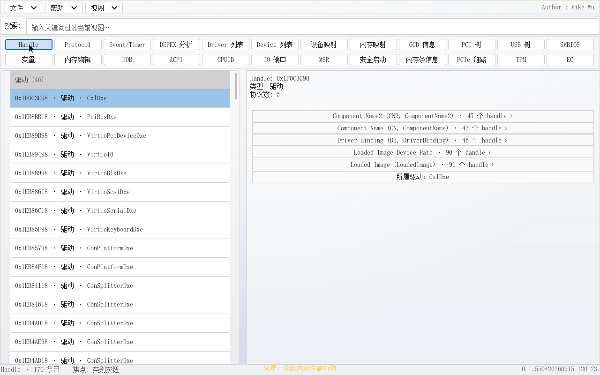 |

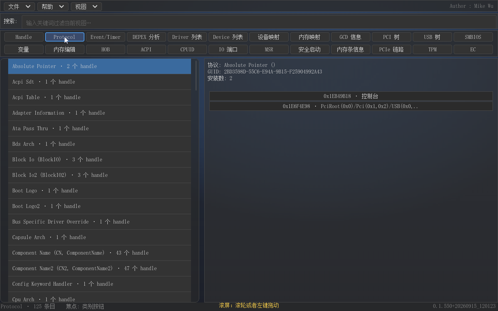

协议中心（M16）：左侧全部已安装协议清单（名字 + 别名 + 安装数，可搜索），右侧安装该协议的 handle 列表——协议 → handle 的反向查询入口。

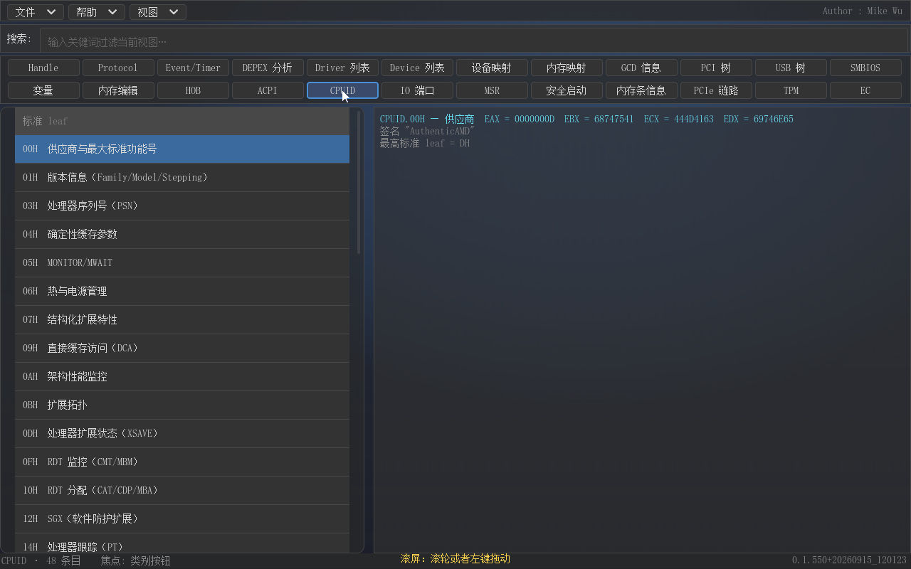

CPUID 视图：左侧 leaf 清单（三组折叠），右侧五列表格逐位域解析，带支持/不支持结论、平台识别与**位域当前值括注**（如 `（当前: 8）`）。

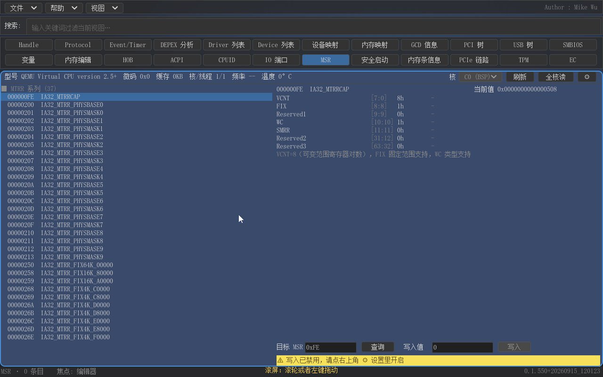

MSR 视图：顶部 CPU 摘要条（型号/微码/缓存/核线程/频率/温度 + 核选择）+ 左侧分组 MSR 清单（危险读条目红色 ⚠ 警示）+ 右侧 64 位值、逐位域解析表与 MTRR 区间解析行。

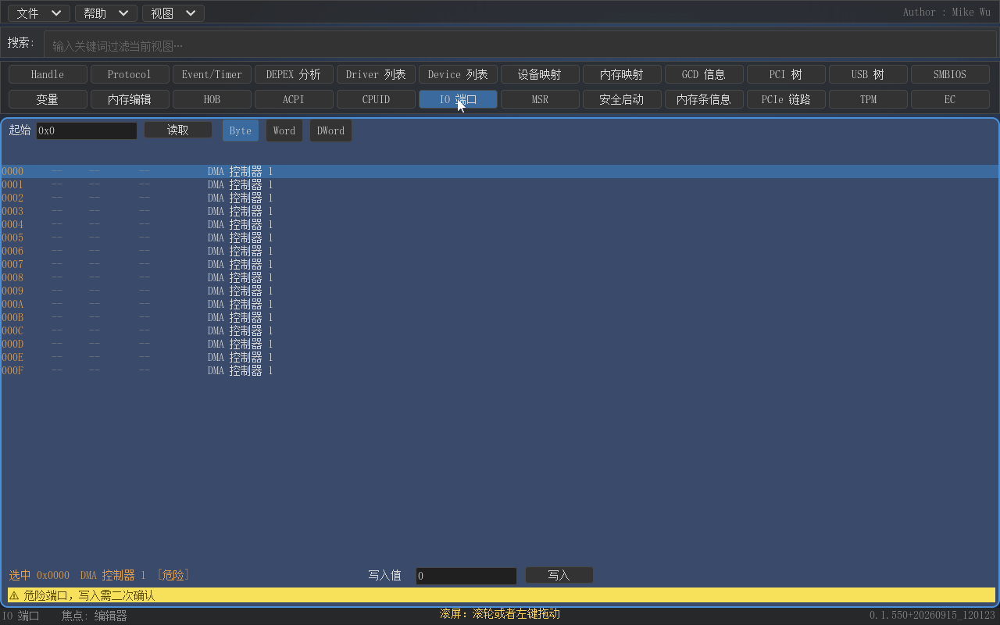

IO 端口视图：控制条（起始地址 + 读取 + 宽度 TabBar）+ 端口值表（地址/Byte/Word/DWord/注解，虚拟滚动）+ 选中端口操作条（写入值 + 写入按钮）+ 双警告条（读取范围/副作用端口、危险端口提示）。写操作三级管控：普通一次确认、危险端口二次确认、致命端口直接拒绝。

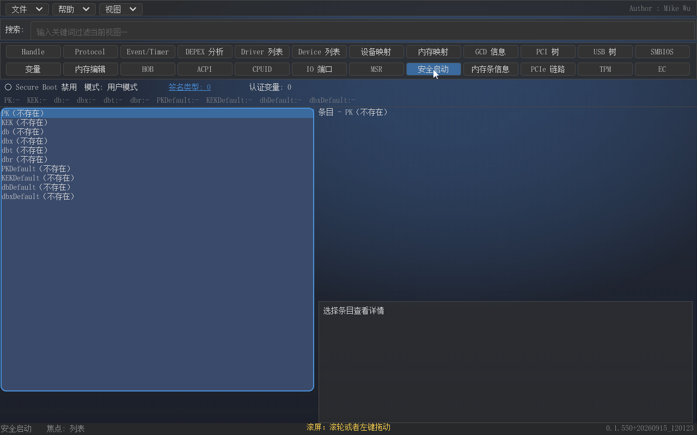

Secure Boot 视图：顶部摘要条（启用徽标 + 派生模式:用户 + 签名类型数 + 认证变量数）+ 左侧签名库列表（PK/KEK/db/dbx 有内容，缺失库灰字"（不存在）"）+ 右侧条目列表（序号/类型/主题 CN/大小），选中 X509 条目可看完整证书解析（CN/序列号/有效期/公钥/SHA256 指纹）。

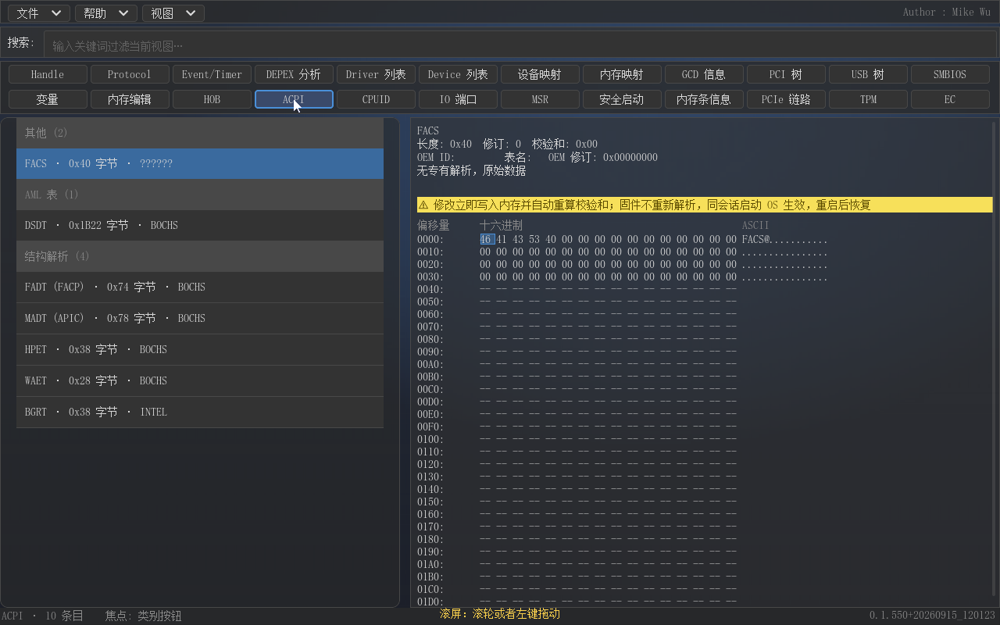

ACPI 视图：全部 ACPI 表按分类列出，普通表逐字段解析（FADT/MADT/FACS…），AML 表（DSDT/SSDT）反编译成 ASL，ASL↔HEX 双向联动，HEX 可编辑、校验和自动重算。

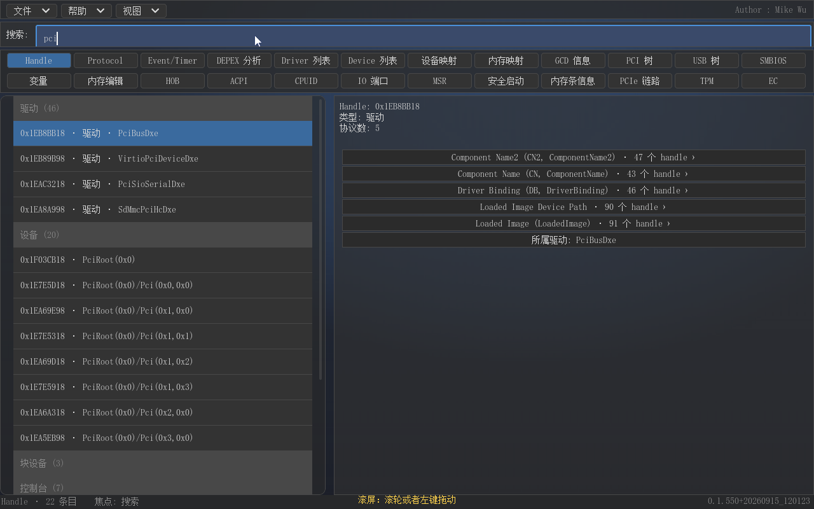

搜索框大小写不敏感过滤当前视图，支持协议别名（搜 "GOP" 命中 Graphics Output）。


文件菜单：刷新 / 保存当前视图为文件…（Ctrl+S）/ 从文件载入…（Ctrl+L）/ 退出。

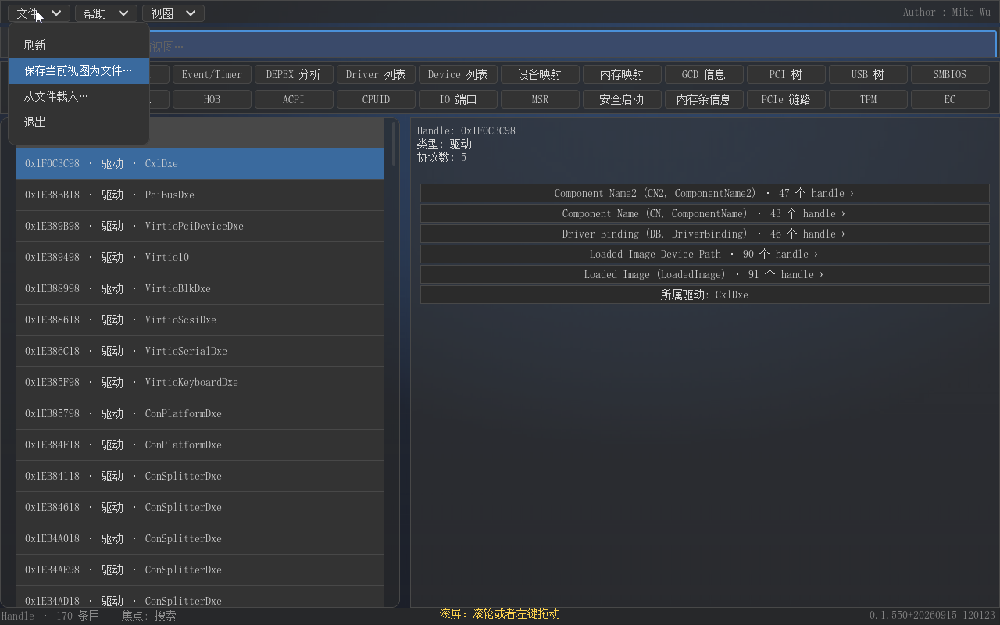

保存对话框（M15）：目标卷下拉 + 推荐文件名（`gud_<功能>_<时间戳>.gud`）+ 保存/取消；标题显示当前视图名，保存对象一目了然。

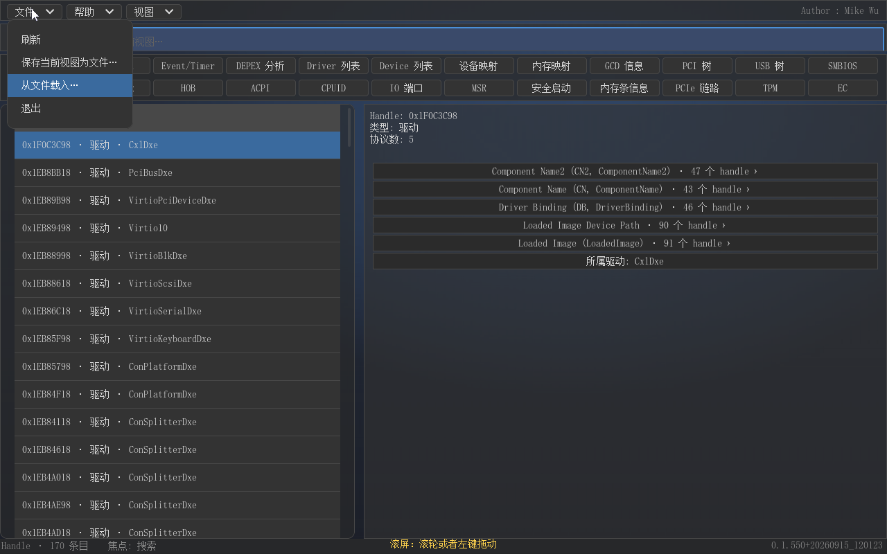

载入对话框：目标卷 + `.gud` 文件列表（Up/Down 键盘选择）；选中后先解析文件头，确认框显示"该文件是 X 视图数据（N 条目），载入并切换到 X 视图？"——按文件内容自动路由，不会载错视图。

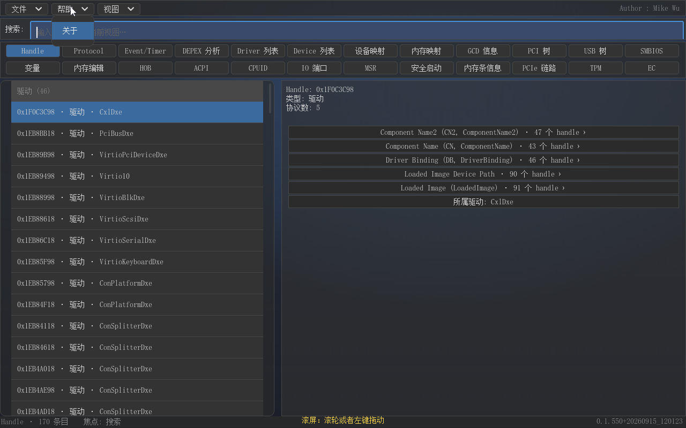

帮助菜单 → 关于：版本、作者与构建信息。

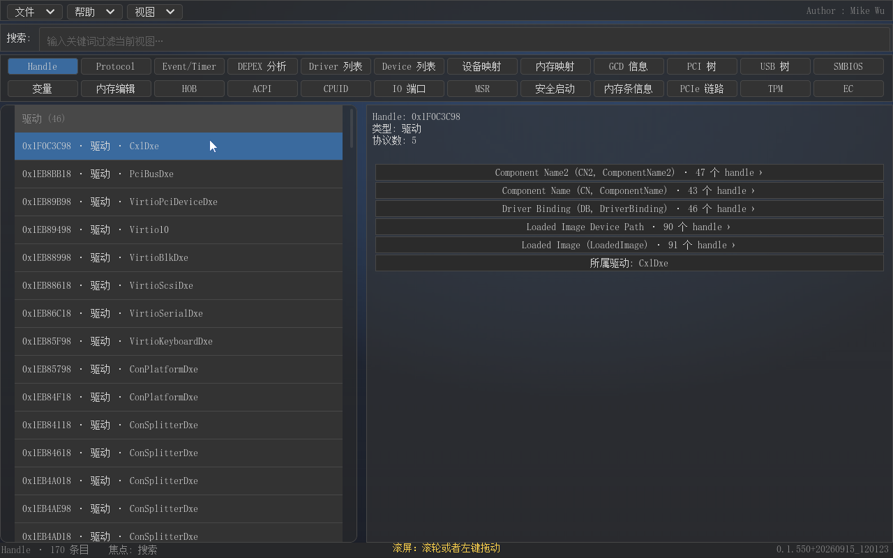

协议中心点击协议行 → 反查安装它的 handle 列表 → 点击跳回 Handle 视图定位。

## 产品手册

为二进制发布编写，随发布物提供：

- **[功能演示 GIF](docs/manual/gudumpinfo-overview.gif)**：18 帧串联主界面与全部 18 个功能视图（每帧 1.2 秒循环播放）
- **[说明书（简版）](docs/manual/gudumpinfo-说明书-简版.md)**（[Word 版](docs/manual/gudumpinfo-说明书-简版.docx)）：一页半快览——功能一览表、独家亮点（协议反查、590 条可读协议名、CPUID 位域当前值、文件模式等）、三步上手
- **[说明书（详版）](docs/manual/gudumpinfo-说明书-详版.md)**（[Word 版](docs/manual/gudumpinfo-说明书-详版.docx)）：10+ 页完整手册——每个功能"怎么用 + 解决什么问题"，含全局搜索/文件模式/快捷键表/已知限制

## 依赖

本包**不包含** LVGL 移植层。构建需要以下独立仓库（以 `PACKAGES_PATH` 方式并列引入）：

| 依赖 | 仓库 | 说明 |
|---|---|---|
| LvglPkg | [MikeWuPing/UEFI_LVGL](https://github.com/MikeWuPing/UEFI_LVGL) | LVGL 9.2.2 官方镜像（原样内置）+ UEFI 适配层（GOP 显示/键盘/鼠标/内存/tick） |

ACPI 反编译引擎（AcpicaPkg，可选）独立开源在 [MikeWuPing/AcpicaPkg](https://github.com/MikeWuPing/AcpicaPkg)。

## 目录结构

```
gudumpinfo/
├── README.md                  # 本文档（中英双语）
├── LICENSE                    # MIT
├── VERSION.txt                # 版本
├── GudumpInfo.efi             # X64 可执行文件
├── GudumpInfo-AARCH64.efi     # ARM64 可执行文件
├── gudumpinfo-boot-0.1.551.iso  # Live CD：UEFI 启动镜像（免 Shell）
└── docs/manual/               # 产品手册（简版/详版 md + docx、演示 GIF、全部配图）
```

## 运行

把 `gudumpinfo.efi`、`startup.nsh` 放进 QEMU 虚拟 FAT 盘启动：

```
Shell> gudumpinfo.efi
```

鼠标验证需要带 USB 鼠标驱动的 OVMF 固件（`-device usb-mouse`；上游 OVMF 默认不含，见 [UEFI_LVGL](https://github.com/MikeWuPing/UEFI_LVGL) 仓库的补丁说明）。一键运行：`tools/Run-GudumpInfoQemu.ps1`（SDL 交互窗口）。

**Live CD（UEFI 启动 ISO，不需要 Shell）**：`tools\New-BootIso.ps1` 一把生成 `dist\gudumpinfo-boot-<版本>.iso`——ISO9660 + UDF bridge + El Torito EFI 引导（双架构 `EFI\BOOT\BOOTX64.EFI`/`BOOTAA64.EFI`，OVMF 读 UDF 层、真实固件读 ISO9660，两面都覆盖）。用途：把 ISO 内容拷到 FAT32 U 盘根目录或刻录/挂载，固件 UEFI 模式从该介质启动——**没有 UEFI Shell、没有操作系统也能直接进入 gudumpinfo 主界面**（固件 Boot Manager 直启 BOOTX64.EFI。**Ventoy 兼容与限制**：本镜像按 Ventoy/VMware 兼容结构构建（内嵌 ESP，双保险引导）——拷入 Ventoy U 盘请在菜单中选择 **正常模式（normal mode）** 启动，**不要选择 GRUB2 模式**（该模式对非标准 UEFI ISO 支持受限）；**Secure Boot 需关闭**（镜像未签名，用后建议恢复））。注意 Secure Boot 须关闭（镜像未签名，用后建议恢复）。ISO 引导闭环验证：`tools\Run-BootIsoVerify.ps1`（QEMU `-cdrom`，无盘无 Shell 断言 APP_VERSION + 截图 + 干净退出）。

## 截图展示

全部截图为 0.1.551 构建实拍（1280×800）。

| 功能 | 截图 |
|---|---|
| 主界面（12 列 24 按钮，20 已实现 + 4 占位）+ Handle 视图（行尾驱动模块名）；深色毛玻璃 |  |
| 浅色毛玻璃（视图菜单切换，`gudumpinfo.cfg` 持久化） |  |
| 协议中心（M16） |  |
| Driver 列表 | 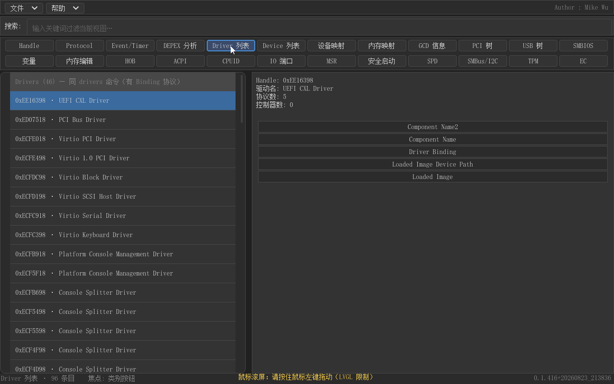 |
| Device 列表（设备实例名） | 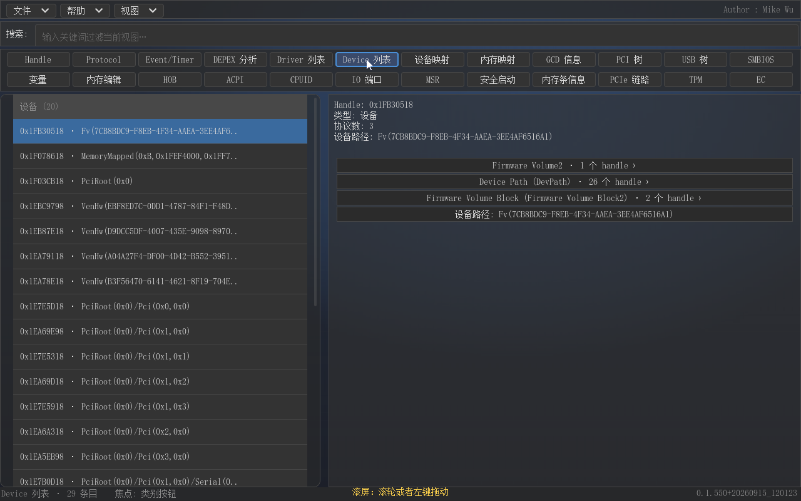 |
| 设备映射 | 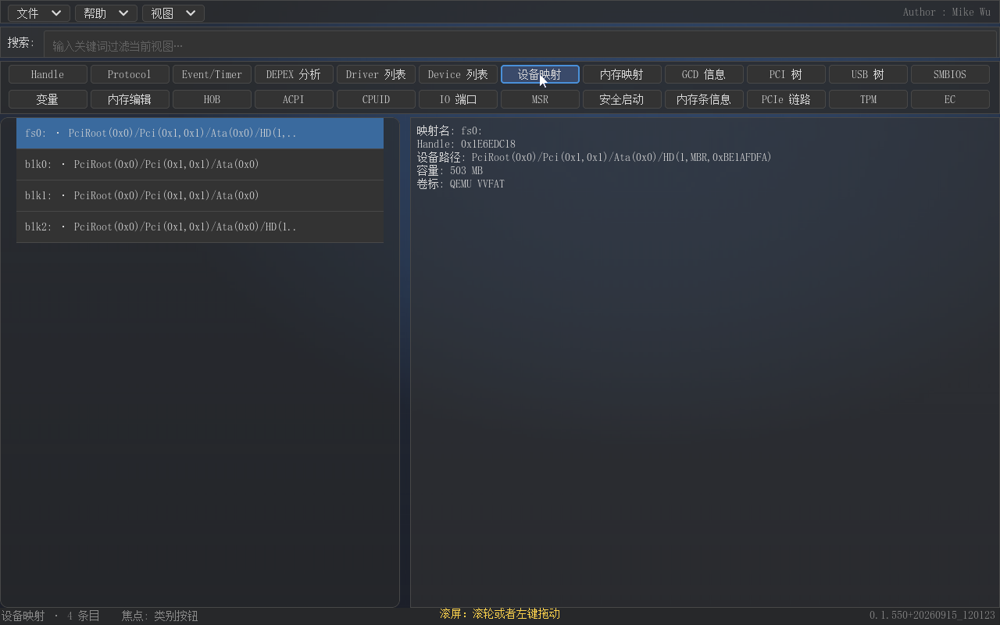 |
| 内存映射 | 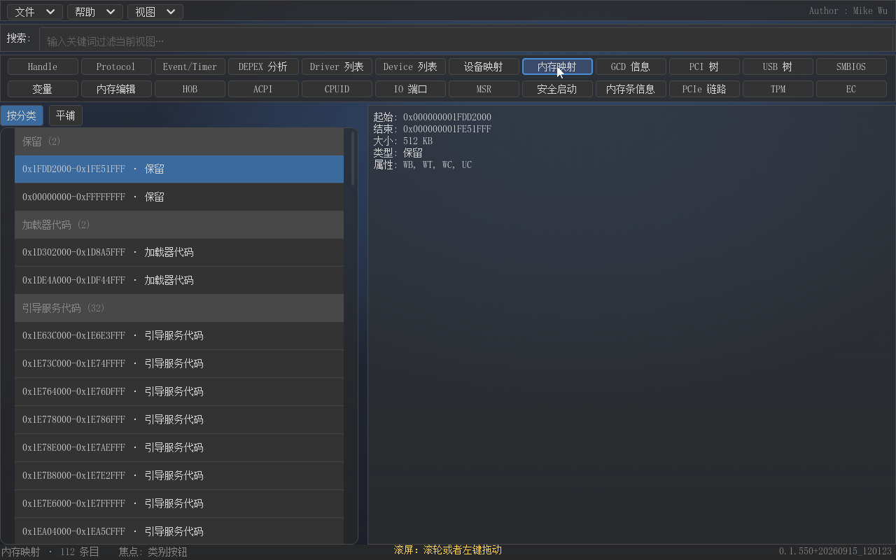 |
| GCD 信息 | 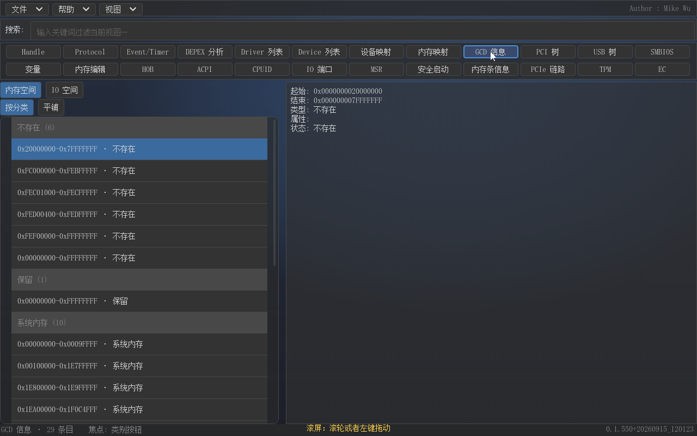 |
| PCI 树 | 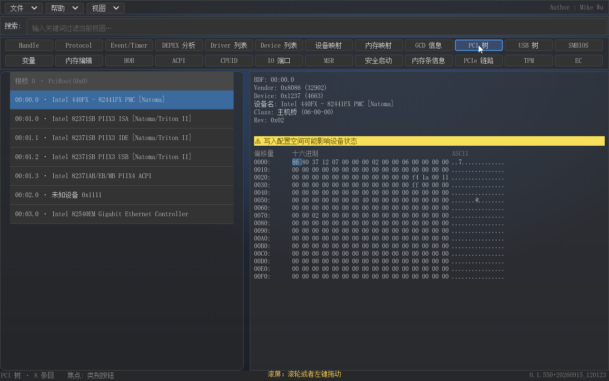 |
| USB 树 | 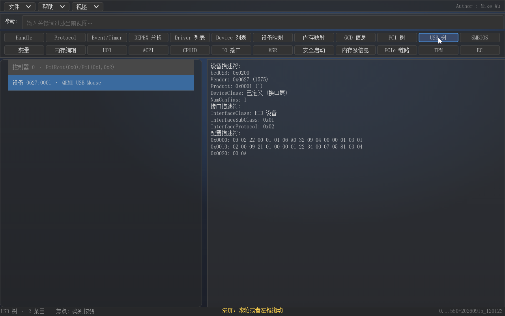 |
| SMBIOS | 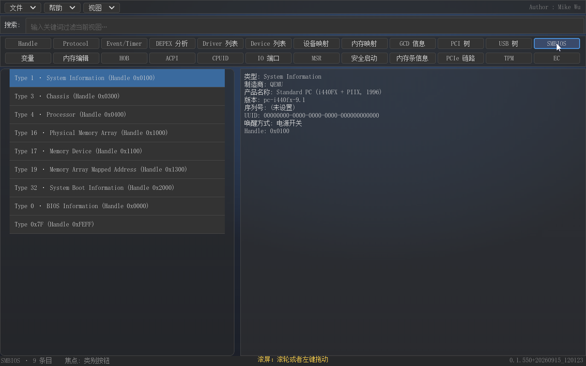 |
| 变量 | 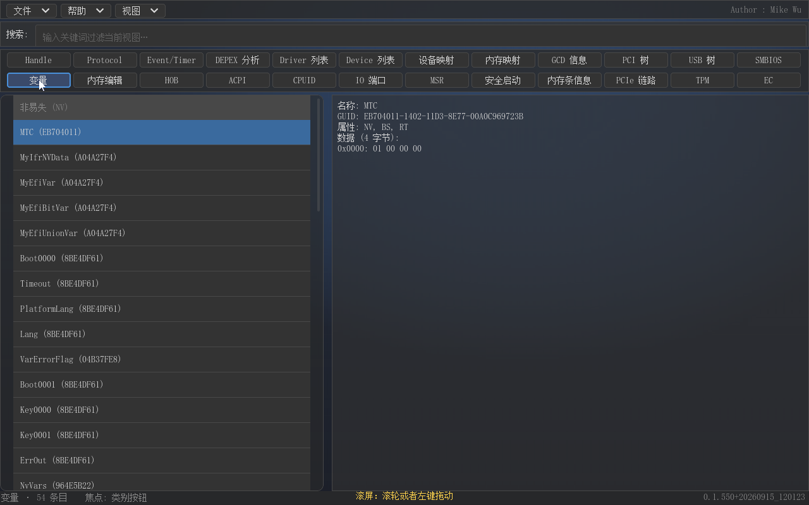 |
| 内存编辑 | 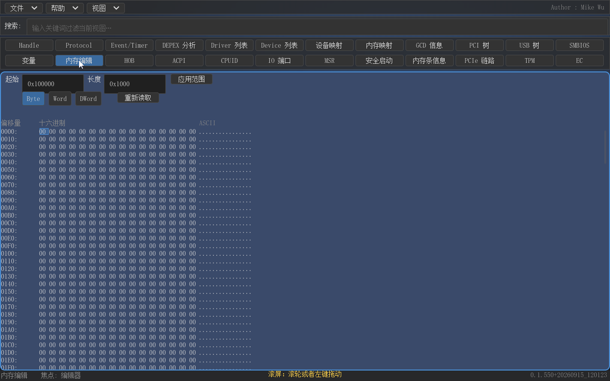 |
| HOB | 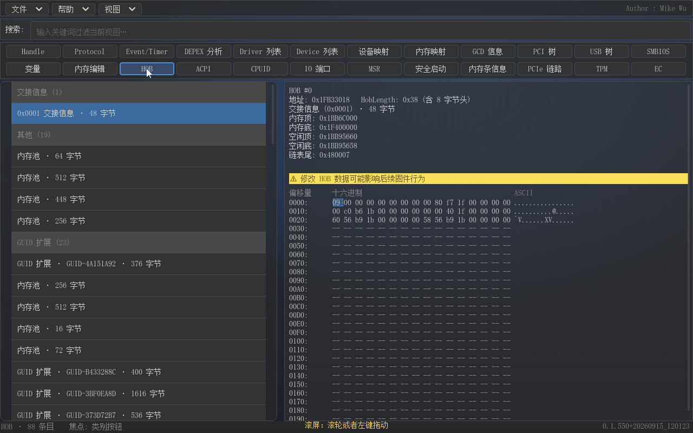 |
| ACPI |  |
| CPUID（位域值括注） |  |
| IO 端口 |  |
| MSR |  |
| Secure Boot |  |
| 搜索过滤（GOP） |  |
| 文件菜单 |  |
| 保存对话框 |  |
| 载入对话框 |  |
| 关于对话框 |  |
| 协议反查跳转 |  |
| Event/Timer（组名/协议名 → 回调模块箭头、自定义信号、×N 触发计数） | 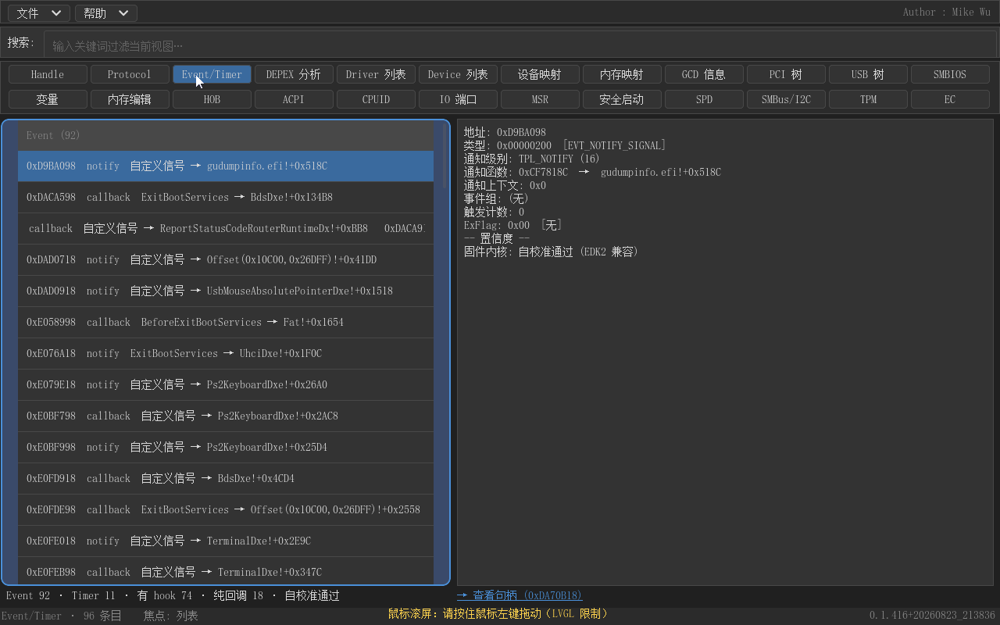 |
| DEPEX 分析（缺依赖/恒假/加载失败疑点分组，按调度状态分组折叠） | 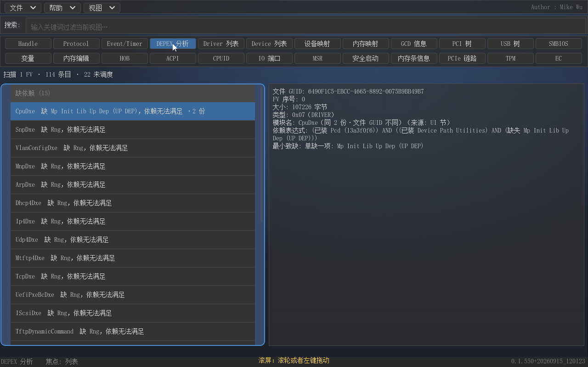 |
| 内存条信息（DDR5 SPD5/小料 MR，真机数据快照回放） |  |
| PCIe 链路（拓扑树 + 全字段解码，真机数据快照回放） |  |

## 已知限制

- 只读当前执行 CPU（BSP）的 CPUID，不做 AP 遍历
- ACPI AML 编辑写回固件内存，同会话生效；重启后恢复（固件不重新解析表）
- 部分保留 leaf（规范未定义）仅显示原始寄存器值；QEMU TCG 对未实现 leaf 返回固定值，已单列"未定义"组展示
- IO 端口视图的写保护分级依据 PC/AT 体系公认语义；**QEMU 环境怪癖**：写 PIC 命令端口 0x20=0xFF（OCW3 特殊屏蔽模式）会破坏 OVMF 的 ACPI 定时器延迟服务导致客户机异常（已二分确证与 app 无关，真机无此问题），QEMU 验证因此跳过危险/致命写实验，仅验证普通读写与 PCI 配置读取
- Secure Boot 视图为**只读展示**（不含 enroll/写入操作）；QEMU 富内容验证需要自编译 OVMF（含 USB 鼠标驱动）并在 pflash 中预运行 `EnrollDefaultKeys.efi` 导入默认密钥——默认 OVMF 下视图呈现未启用状态（Secure Boot 禁用、设置模式、各库"（不存在）"）
- Save/Load（M15）：IO 端口视图不支持保存/载入（其数据在真机上才有意义，菜单提示"该视图不支持保存"）；保存目标为卷根目录（fs0:/fs1:… 弹窗选择），文件名默认 `gud_<功能>_<时间戳>.gud` 可改；载入为**数据级回放**（内存编辑载入后仍是编辑器，编辑只改内存缓冲不落盘，Ctrl+R 即恢复实时）；`.gud` 文件为自定义格式（`GUDINFO` 签名 + 功能签名 + 双校验和），宿主校验脚本见 `tools/check_gud_file.py`
- ACPI 表头 Length 钳制（M15 修复）：部分固件（如 NUC8i7BE 的 AMI BIOS）的 DSDT 表头 Length 是编译时值（可到 256KB+），运行时表内存却被截断到 64KB 且表头未同步——按 Length 反编译会越界读表缓冲外内存而死机。app 在收集时用 GetMemoryMap 查表地址所在连续 RAM 描述符链，**把 Length 钳制到实际可读边界**（只缩不扩，能读多少是多少），反编译/校验和/HexEdit/保存全下游安全；保存按钳制后长度抓取完整可读数据（不再 64KB 截断）
- 大表反编译进度条（M15）：256KB 级 DSDT 反编译可达分钟级，反编译期间 ASL 分栏顶部显示**进度条**（按 AML 偏移推进，实时渲染），明确"界面活着"而非死机；反编译完成即消失。若输出缓冲增长失败（真机内存紧张），串口会打 `output grow fail ... TRUNCATED`（此前的静默截断会导致 ASL 显示不全）
- 设备实例名（M16）：设备名来自驱动 `ComponentName2->GetControllerName`（"en"→"eng" 两轮尝试），驱动未实现该接口或拒绝时该行省略；bus 驱动创建的 child 设备因驱动不对其持有 BY_DRIVER open 关系而拿不到名字（比 Shell `devices` 略窄）；搜索在 Pci/USB/SMBIOS/变量/HOB 等部分视图仍区分大小写（Handle/协议/CPUID/驱动/设备已统一不敏感，其余视图留待后续统一）

## 兄弟项目

- [gsetupmod](https://github.com/MikeWuPing/gsetupmod) —— 固件设置浏览器：解析 HII/IFR 重建 BIOS Setup，展示被固件隐藏的选项
- [UEFI_Test_Suite](https://github.com/MikeWuPing/UEFI_Test_Suite) —— UEFI 硬件诊断工具套件
- [pcDig](https://github.com/MikeWuPing/UEFI_Test_Suite/tree/main/pcDig) —— UEFI 整机硬件诊断：21 项自检（CPU/内存/存储/显存/网络/USB/输入设备/启动诊断/事件日志），免 Shell 可启动 ISO
- [guedit](https://github.com/MikeWuPing/guedit) —— UEFI Shell 下的图形化文本编辑器（LVGL）
- [gufile](https://github.com/MikeWuPing/gufile) —— UEFI Shell 下的 GUI 文件管理器（Explorer 式界面）
- [mount](https://github.com/MikeWuPing/mount) —— UEFI Shell 挂载工具：NTFS/ext4/ISO 卷挂载与 ISO 虚拟块设备

## 许可证

MIT License。参见 [LICENSE](LICENSE)。

---

## English

# gudumpinfo — Graphic UEFI System Info Viewer

gudumpinfo is a GUI system-information viewer that runs directly in the **UEFI Shell** — the UEFI-world equivalent of a desktop system-info tool, without any operating system underneath. Built on the LVGL graphics library with a fully simplified-Chinese UI (built-in SimSun CJK font) and mouse & keyboard input, it covers everything a firmware developer needs for day-to-day debugging: handles/protocols, devices, drivers, mappings, memory map, GCD, PCI tree, USB tree, SMBIOS, UEFI variables, HOB list, ACPI tables — and a deep **CPUID** analyzer. **Supports X64 and AArch64 from a single source tree** (the x86-only views CPUID / IO ports / MSR gray out automatically on AArch64; everything else works identically — see the Build section).

**Version 0.1.551 (2026-09-15)** ｜ [Latest Release](https://github.com/MikeWuPing/gudumpinfo/releases)


> In the firmware world, finding out what your CPU actually is — or what the ACPI tables really say — shouldn't require a command line.


- **Author**: Mike Wu
- **License**: MIT
- **GUI library**: [LVGL 9.2.2](https://lvgl.io) (open-sourced separately, see Dependencies)
- **UI language**: Simplified Chinese (built-in SimSun CJK font)
- **Product manual**: [Demo animation](docs/manual/gudumpinfo-overview.gif) ｜ [Brief manual](docs/manual/gudumpinfo-说明书-简版.md) ｜ [Detailed manual](docs/manual/gudumpinfo-说明书-详版.md)

## Features

- **22 information views + 2 upcoming placeholders** (button-navigated, 12-column button bar, 24 buttons in two full rows; TPM/EC are upcoming placeholders — the SPD placeholder became the 内存条信息 (Memory Info) view and SMBus-I2C became the PCIe 链路 (PCIe Link) view):
  - **Handles/Protocols**: handle → protocols (**590+ entry readable-name table**: all edk2 packages + gEdkii + MTL platform protocols, with **common abbreviations** such as Graphics Output (GOP); each protocol row shows its **install count** "· N handles", click for reverse lookup) → DevicePath
  - **Protocols (M16)**: an **all-installed-protocols** center — left list (name + alias + install count, searchable) → right list of owning handles → click to jump back to the Handle view; .gud save/load supported
  - **Devices / Drivers / Mappings**: device paths, **device instance names** (best-effort via ComponentName2, e.g. "QEMU Video PCI Adapter"), driver bindings, fs0:/blk0: volumes
  - **Memory Map**: GetMemoryMap descriptors, grouped or flat
  - **GCD**: memory + IO space maps with sub-tabs
  - **PCI / USB trees**: full-scanned device trees, config-space hex viewer, Enter jumps to the device's handle page
  - **SMBIOS**: Type 0/1/2/3/4… field-by-field Chinese annotations
  - **Variables**: GetNextVariableName enumeration grouped by attribute (NV/RT/volatile)
  - **Memory Editor / HOB**: hex editor (direct UEFI memory read/write), HOB list + editor
  - **ACPI**: all tables grouped, plain tables field-decoded (FADT/MADT/FACS…), **AML tables (DSDT/SSDT) disassembled to ASL** with **ASL↔HEX bidirectional linking** (click an ASL line to highlight its byte range), editable HEX with **automatic checksum recalculation**
  - **CPUID**: full leaf collection (standard 0x00-0x2F + extended 0x80000000-0x26), **table-formatted bit-field decoding** — `Field | Bits | Value | Result | Description` per row, 1-bit feature bits show an explicit **Supported/Not-supported** conclusion; the description column appends the **current value** (enum Chinese name or decimal, e.g. `（当前: 8）`, M16); 41 leaf definitions, 2470 bit fields, 577 Chinese annotations (Key Locker/PCONFIG/LBR/AMX/TMUL/SGX/ArchPerfmon plus the full AMD Zen4/Zen5 set, all verified against Intel SDM / AMD APM); **platform recognition** (Meteor Lake/Arrow Lake/Panther Lake model tables from official EDS); three collapsible list groups (standard/extended/**undefined**)
  - **IO Ports**: x86 IO space (0x0000-0xFFFF) **read/write in Byte/Word/DWord widths** — windowed browsing (256 ports/window, no auto-read on paging), built-in **common-port annotation table** (~60 ports: DMA/PIC/PIT/keyboard/CMOS/POST/serial/parallel/ATA/VGA/PCI config, danger ports marked red/orange); **strong write protection**: zero access on entry, every access explicitly triggered; three-tier write control — single confirm for normal ports, **double confirm for danger ports** (PIC/PIT/DMA/CMOS/PCI config 0xCF8/0xCFC…), **hard reject for fatal ports** (reset 0xCF9/0x92, CMOS index 0x70, keyboard command 0x64, SuperIO index); width-alignment rule (odd ports Byte-only); side-effect read ports (0x60/0x64) warned; PCI config-space reads via 0xCF8 (address) + 0xCFC (data)
  - **MSR**: x86 model-specific register **read/write** — left grouped MSR list (**1359-entry auto-generated knowledge table**: 358 MdePkg architectural + 1001 MTL platform MSRs, addresses/names/bitfields/read-only flags, collapsible groups), right **64-bit value + per-bitfield decode table** (bits/field/value/description), **dedicated MTRR parsing** (PHYSBASE/PHYSMASK pairs resolve memory ranges: from-to, size, UC/WC/WT/WP/WB type; fixed-range segment summaries; DEF_TYPE default type + FE/E enable bits); top CPU summary bar (model/microcode/cache/cores-threads/frequency/temperature); **per-core selection + all-core batch read** (MP Services); **three-tier write protection** (fatal greyed / danger double-confirm / normal single-confirm, writes disabled by default until enabled in ⚙ settings); **danger-read blocking** (APIC/X2APIC registers that hang the machine shown in red and never read); optional **#GP-safe read hook** (EFI_CPU_ARCH_PROTOCOL, off by default)
  - **Event/Timer (new)**: full-system event & timer scan — memory scan of
  EDK2 IEVENT objects ('evnt' signature + multi-layer validation +
  self-calibration firmware check); left list grouped into **Event**
  (group/protocol-notification events, collapsible headers with counts)
  and **Timer** (periodic timers with estimated period & armed state);
  right detail per-field (type bits, notify TPL, notify function address
  with **module name** (OVMF GUID map / PDB reverse lookup on real
  DEBUG BIOS, DevicePath fallback), event group GUID, signal count,
  ExFlag, timer period/next-trigger); protocol-notification events show
  the **mounted protocol name** (e.g. Loaded Image); a **View Handle**
  link below the detail jumps to the Handle view; global search
  case-insensitive fuzzy match ("exit" hits ExitBootServices group
  events; also by protocol/module name, notify level); .gud save/load
  (168-byte fixed records)
  - **Memory Info (SPD, new)**: DDR5 sideband diagnostics — left slot list (dot / DIMM type / vendor / capacity / speed / SN) → right 11-section collapsible panel: SPD5 Hub (SPD5118, 1024B NVM) identification chain (MR0/1/5, hub判定), CRC verdict (stored vs computed, mismatch in red), manufacturing/timings/die (NVM ASCII, vendor/date, CL/RCD/RP…, die organization & width), **companions & write-protect** (PMIC/RCD/TS MR register sections with type/vendor/rev headers and full JEDEC field decoding; 16-block write-protect bitmap with locked blocks in red), **reconciliation** (SPD ↔ SMBIOS Type17 per-slot cross-check with mismatch rows highlighted); **auto-selected data path** (standard SMBus / CPU I3C private protocol / CPU sideband CSR three-source chain / BDAT MRC snapshot / SMBIOS-summary fallback — ARM degrades correctly with an x86-only depth notice); SPD-section .gud replay
  - **PCIe Link (new)**: RW-Everything-style PCIe topology & link diagnostics — **bridge-reachability BFS topology tree** (from each RC via Type1 Sec/Sub recursion, only buses with devices; multi-RC/multi-socket segments), rows carry **exact EDS device names** (148 official GNR/ARL/PCH Device Mapping entries) / pci.ids fallback (5542 full Intel IDs) / raw hex, plus BDF + class + negotiated rate×width + bandwidth + ASPM/AER badges; detail pane decodes **Link** (current/target/max rate & bandwidth, Gen1-6 with FLIT), **ASPM** (supported/enabled/current + L1.1/L1.2), **AER** (UC/C status bitmaps, masks, severity, header log, software-accumulated error counts), **ECaps** (RBAR/DPC/L1SS/VC/ACS/PTM group-by-group), full capabilities and raw dumps; **diagnostic writes** (link retrain / AER clear / ASPM switch with confirm dialogs and read-back verification); **ACPI reconciliation** (DSDT `_ADR` device count vs scanned tree, manual trigger + progress bar); PCIP-section .gud replay
- **Secure Boot**: read-only view of Secure Boot state and certificate stores — top **summary bar** (enabled/disabled badge + **derived mode**: Setup/User/Deployed/Audit from the SetupMode/DeployedMode/AuditMode state machine + signature-type count + authenticated-variable count, second row per-store `type:count` overview, click "签名类型:N" for the full list); left list of the **six standard signature stores** (PK/KEK/db/dbx/dbt/dbr) + the Default series (PKDefault/KEKDefault/dbDefault/dbxDefault) + **all authenticated variables** (EFI_VARIABLE_AUTHENTICATED_ACCESS_ACCESS third-party variables such as shim's MokList, name-sorted, capped at 64); right table of signature entries (index/type/subject CN or hash digest/size) with **detailed X509 certificate parsing** for the selected entry (hand-rolled light DER: subject/issuer CN/O/C/OU, serial number, validity period, public-key algorithm & bit length, **SHA256 fingerprint**); SHA256-hash signatures shown in full 32 bytes; missing stores greyed as "not present", signature-list overruns marked red "parse failed" without affecting other stores; Tab cycles the left store list / right entry list focus zones, Ctrl+F searches store names; all data comes from UEFI variables (SecureBoot/SetupMode/PK/KEK/db/dbx…), no enroll/write operations
  - **Save As / Load From File (M15)**: File menu "**Save current view as file…**" (Ctrl+S) / "**Load from file…**" (Ctrl+L) — dumps any view's raw collected data into a `.gud` file (volume picker + suggested name `gud_<feature>_<timestamp>.gud`), replayable **at the data level** on another machine or in QEMU (ACPI tables re-disassemble after load, the memory editor works on loaded data, status bar shows "已载入"); the file header carries the `GUDINFO` signature + per-feature signature + dual byte-sum checksums, and parsing tolerates corrupt/truncated records (bad records skipped, partially-usable files still load); **every view except IO ports** is supported, loading auto-routes to the owning view, Ctrl+R returns to live data — save a real-machine failure site and reproduce it in QEMU
- **Search**: global search box, **case-insensitive** matching of titles, protocol names and **aliases** (typing "GOP" finds Graphics Output), hex leaf numbers, field names and Chinese descriptions
- **Appearance**: dark/light **glass** themes (wallpaper + downsampled blur + translucent glass card covering the whole screen, zero layout shift); switch via the menu bar "视图 → 深色/浅色毛玻璃", the choice is persisted to `gudumpinfo.cfg` on the **boot volume** (`theme=dark|light`, dark by default) and applied on the next launch; on read-only media (Ventoy live CD, etc.) a failed write only prints a notice
- **Full keyboard operation**: Windows-style **Tab focus-zone cycle** (menu → search → category buttons → list → detail/actions → editor) with focus highlight/lowlight and the zone name in the status bar; **menus are fully keyboard-driven** (←/→ switch 文件/帮助/视图, ↓ or Enter opens, ↑/↓ selects, Enter activates, Esc closes, Tab closes an open menu and moves on); **dialogs cycle their controls with Tab** (confirm box 确定/取消, save/load control ring, MSR settings' three controls), Enter/Space activates the focused control; three-level Esc (clear search → view back → close dialog), Ctrl+F search, Ctrl+S/Ctrl+L save/load, Ctrl+R refresh
- **Mouse**: **wheel scrolling** (lists/details/menus) and left-button drag scrolling; **when the firmware ships no mouse driver the app brings its own** — an embedded USB HID boot-mouse driver scans USB devices, switches the endpoint to boot protocol, installs SimplePointer and hands the device back to the firmware on exit; it stays out of the way when a real pointer device already exists (two consumers on one endpoint would split the reports)
- **Custom table widget**: virtual scrolling (CodeView-style), no memory pressure on thousands of rows

## Dependencies

This package does **not** bundle the LVGL port layer. Build with the following independent repos side-by-side via `PACKAGES_PATH`:

| Dependency | Repo | Description |
|---|---|---|
| LvglPkg | [MikeWuPing/UEFI_LVGL](https://github.com/MikeWuPing/UEFI_LVGL) | LVGL 9.2.2 upstream mirror (untouched) + UEFI adaptation layer (GOP display / keyboard / mouse / memory / tick) |

The ACPI disassembler engine (AcpicaPkg, optional) is open-sourced separately at [MikeWuPing/AcpicaPkg](https://github.com/MikeWuPing/AcpicaPkg).

## Directory Layout

```
gudumpinfo/
├── README.md                  # This document (bilingual)
├── LICENSE                    # MIT
├── VERSION.txt                # Version
├── GudumpInfo.efi             # X64 binary
├── GudumpInfo-AARCH64.efi     # ARM64 binary
├── gudumpinfo-boot-0.1.551.iso  # Live CD: bootable UEFI image (no Shell)
└── docs/manual/               # Product manuals (brief/detailed md + docx, demo GIF, all screenshots)
```

## Run

Place `gudumpinfo.efi` and `startup.nsh` on a QEMU virtual FAT drive:

```
Shell> gudumpinfo.efi
```

Mouse support requires an OVMF build with the USB mouse driver (`-device usb-mouse`; upstream OVMF lacks it — see [UEFI_LVGL](https://github.com/MikeWuPing/UEFI_LVGL) for patches). One-click run: `tools/Run-GudumpInfoQemu.ps1` (SDL interactive window).

**Live CD (bootable UEFI ISO, no Shell needed)**: `tools\New-BootIso.ps1` produces `dist\gudumpinfo-boot-<version>.iso` — ISO9660 + UDF bridge + El Torito EFI (dual-arch `EFI\BOOT\BOOTX64.EFI` / `BOOTAA64.EFI`; OVMF reads the UDF view, real firmware the ISO9660 view — both covered). Copy the ISO contents to the root of a FAT32 USB stick or burn/mount it; boot in UEFI mode and the firmware loads BOOTX64.EFI straight from the removable-media path — **no UEFI Shell and no OS needed**. Secure Boot must be off (unsigned image; re-enable afterwards). ISO boot verification: `tools\Run-BootIsoVerify.ps1` (QEMU `-cdrom`, no-disk/no-Shell APP_VERSION assert + screenshot + clean quit).

## Screenshots

All screenshots were taken from the 0.1.551 build (1280×800).

| Feature | Screenshot |
|---|---|
| Main window (22 buttons) + Handle view; dark glass (default) |  |
| Light glass theme (switched from the View menu, persisted in `gudumpinfo.cfg`) |  |
| Protocols center (M16) |  |
| Driver list |  |
| Device list (instance names) |  |
| Device mappings |  |
| Memory map |  |
| GCD |  |
| PCI tree |  |
| USB tree |  |
| SMBIOS |  |
| Variables |  |
| Memory editor |  |
| HOB |  |
| ACPI |  |
| CPUID (field value suffix) |  |
| IO ports |  |
| MSR |  |
| Secure Boot |  |
| Search filter (GOP) |  |
| File menu |  |
| Save dialog |  |
| Load dialog |  |
| About dialog |  |
| Protocol reverse lookup |  |
| Event/Timer (group/protocol → callback module arrows, ×N signal counts) |  |
| DEPEX analysis (missing-dependency groups, collapsible by reason) |  |
| Memory Info (DDR5 SPD5/companion MR, real-machine replay) |  |
| PCIe Link (topology tree + full field decode, real-machine replay) |  |

## Known Limitations

- CPUID reads the current (BSP) CPU only — no AP traversal
- ACPI AML edits write back to firmware memory and take effect this session; a reboot restores the original (the firmware does not re-parse the tables)
- Some reserved leaves (undefined by the spec) show raw register values only; QEMU TCG returns a fixed value for unimplemented leaves — these are grouped separately under "undefined"
- IO write protection tiers follow widely accepted PC/AT semantics; **QEMU environment quirk**: writing the PIC command port 0x20=0xFF (an OCW3 special-mask command) breaks OVMF's ACPI-timer delay service and faults the guest (bisection-proven unrelated to the app; real hardware has no such issue) — QEMU verification therefore skips the danger/fatal write experiments and covers normal read/write plus PCI config reads
- The Secure Boot view is **read-only** (no enroll/write operations); rich-content verification under QEMU needs a self-built OVMF (with the USB mouse driver) plus `EnrollDefaultKeys.efi` run beforehand in pflash to import the default keys  — stock OVMF shows the disabled state (Secure Boot off, Setup Mode, stores "not present")
- Save/Load (M15): the IO ports view does not support save/load (its data is only meaningful on real hardware; the menu says "该视图不支持保存"); files land in the selected volume root (fs0:/fs1:/…), the default name `gud_<feature>_<timestamp>.gud` is editable; loading is a **data-level replay** (the memory editor keeps editing loaded data — edits only touch the in-memory buffer, never the file, and Ctrl+R returns to live data); the `.gud` format is app-specific (`GUDINFO` signature + feature signature + dual checksums), host-side validation script: `tools/check_gud_file.py`
- ACPI header Length clamping (M15 fix): some firmware (e.g. NUC8i7BE AMI BIOS) ships a DSDT whose header Length is the compile-time value (up to 256KB+) while the runtime table memory is truncated to 64KB with the header not updated — disassembling by Length reads past the table buffer and crashes. On collect, the app uses GetMemoryMap to find the contiguous RAM descriptor chain containing the table and **clamps Length to the actually readable boundary** (shrink-only — keeps whatever is readable), making disasm/checksum/HexEdit/save safe downstream; save captures the full readable data (no more 64KB truncation)
- Large-table disassembly progress bar (M15): disassembling a 256KB-class DSDT takes minutes; during the pass a **progress bar** renders at the top of the ASL pane (advances by AML offset, live-refreshed) so the UI visibly stays alive instead of looking hung, and disappears when done. If the output buffer fails to grow (tight real-machine memory), the serial log prints `output grow fail ... TRUNCATED` (previously a silent truncation that showed as a partial ASL view)
- Device instance names (M16): device names come from the driver's `ComponentName2->GetControllerName` ("en" → "eng" two attempts); the row is omitted when the driver lacks the interface or refuses; child devices created by bus drivers get no name (the driver holds no BY_DRIVER open on them — slightly narrower than Shell `devices`); search remains case-sensitive in a few views (PCI/USB/SMBIOS/Variables/HOB — Handle/Protocols/CPUID/Drivers/Devices are unified, the rest left for a later pass)

## Sister Projects

The developer's other UEFI series tools:

- [gsetupmod](https://github.com/MikeWuPing/gsetupmod) — Firmware settings browser: rebuild BIOS Setup by parsing HII/IFR, exposing hidden options
- [UEFI_Test_Suite](https://github.com/MikeWuPing/UEFI_Test_Suite) —— UEFI hardware diagnostics, testing and repair-assist tools
- [pcDig](https://github.com/MikeWuPing/UEFI_Test_Suite/tree/main/pcDig) — UEFI whole-machine diagnostics: 21 self-test checks, shell-free bootable ISO
- [guedit](https://github.com/MikeWuPing/guedit) — GUI text editor for UEFI Shell (LVGL)
- [gufile](https://github.com/MikeWuPing/gufile) — GUI file manager for UEFI Shell (Explorer-style)
- [mount](https://github.com/MikeWuPing/mount) — UEFI Shell mount tool: NTFS/ext4/ISO volume mounting and ISO virtual block devices

## License

MIT License. See [LICENSE](LICENSE).
