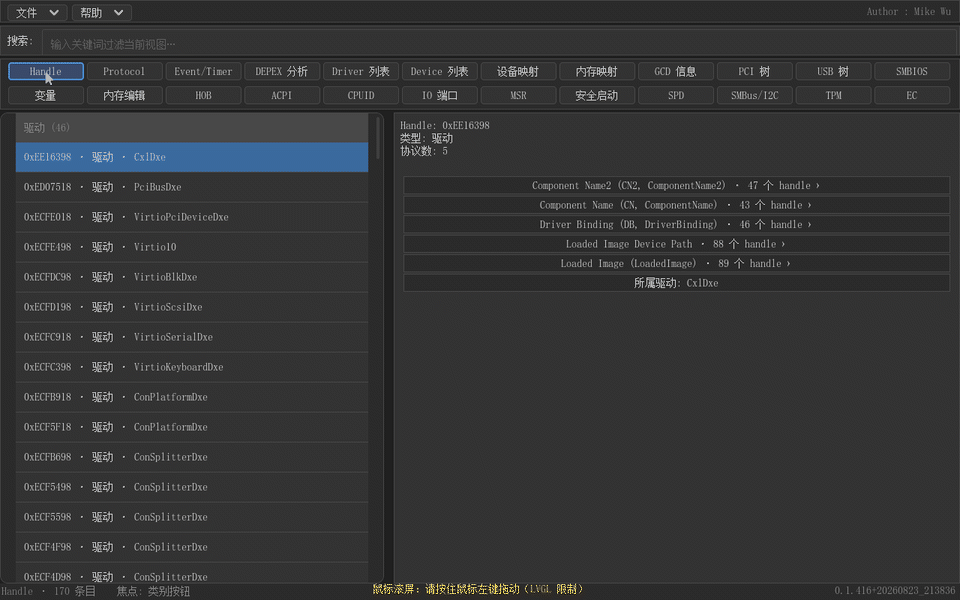
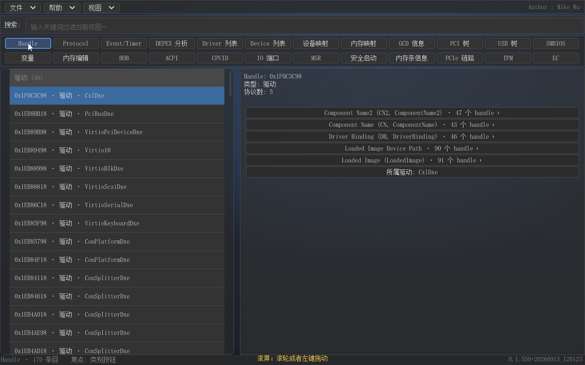
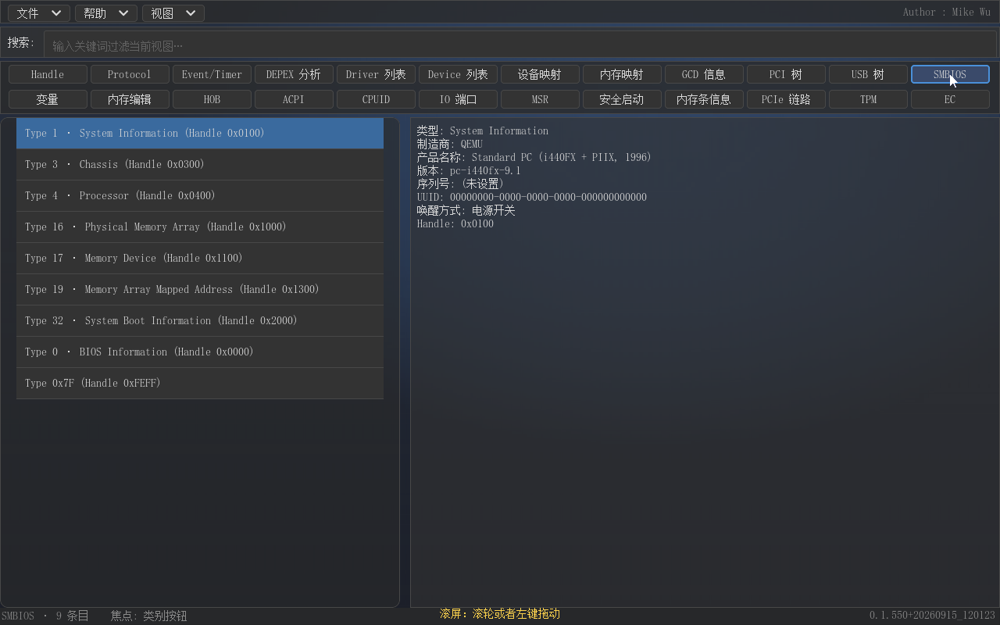
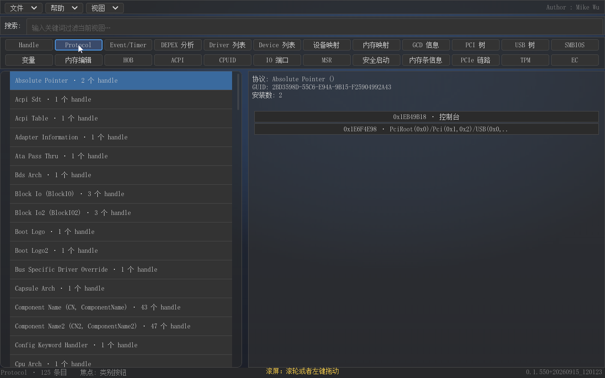
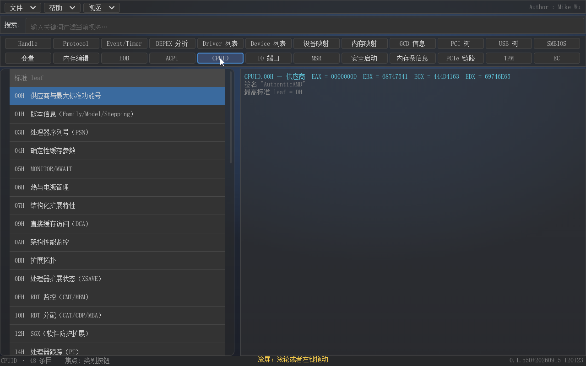
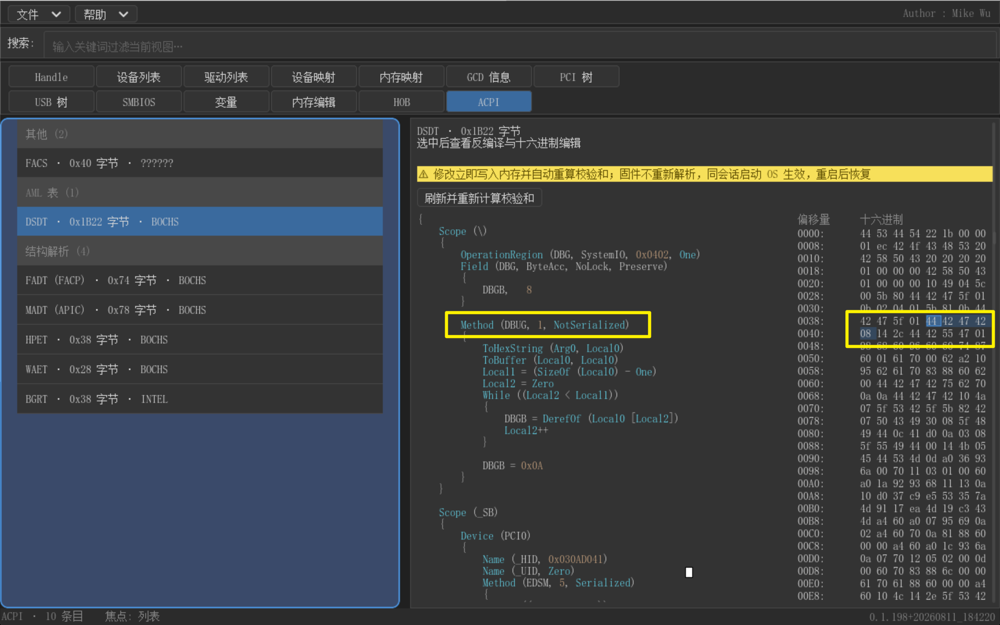

# gudumpinfo 产品说明书（简版）

**gudumpinfo 是运行在 UEFI Shell 环境下的 GUI 系统信息查看器：把 UEFI 世界散落的命令行工具聚合为一张中文图形界面，一键查看全部系统信息。**

*适用版本 0.1.515 ｜ 2026 年 9 月*

## 前言

以下 GIF 演示主界面与全部 20 个功能视图。

## 产品概述

UEFI 开发与固件调试中，查看系统信息是最高频的动作之一。传统做法是进入 UEFI Shell，依次敲 dh、devices、drivers、map、memmap、pci、usbtree、smbiosview、dmpstore 等命令：命令名难记、输出是纯文本、格式各异，不同命令之间的关联——比如某个 protocol 到底挂在哪几个 handle 上——只能靠人脑拼接。信息本身不缺，缺的是把它们组织起来的方式。

gudumpinfo 正是为解决这个问题而生。它以 LVGL 图形库构建全中文 GUI，Windows 11 风格，鼠标与键盘焦点双支持，把 22 类系统信息各做成一个按钮，点击即看，无需记忆任何命令。它更不是简单的"命令换皮"——协议反向查询、CPUID 位域解析、内存侧带与 PCIe 拓扑诊断、数据存盘取证等能力，是 Shell 命令行给不出的，下文逐一说明。

## 功能一览

主界面左侧排列全部 24 个功能按钮（22 个已实现视图 + 2 个开发中占位），右侧为内容区。下表列出各视图与 UEFI Shell 命令的对应关系，"独家"表示该能力没有对应的 Shell 命令。

| 功能视图 | 相当于 Shell 命令 | 说明 |
|---|---|---|
| Handle | dh | 全部 handle 及其挂载的 protocol、device path |
| 协议中心 | 独家 | 全量协议聚合统计与安装数徽标，支持协议反查 handle |
| Driver 列表 | drivers | 驱动列表，协议以可读名展示 |
| Device 列表 | devices / devtree | 设备列表，实例名取自 ComponentName2 |
| 设备映射 | map | 块设备与文件系统映射（blk0:、fs0:），附 DevicePath |
| 内存映射 | memmap | 内存图 |
| GCD 信息 | 无 | GCD 空间信息 |
| PCI 树 | pci | PCI 设备树 |
| USB 树 | usbtree | USB 设备树 |
| SMBIOS | smbiosview | SMBIOS 信息 |
| 变量 | dmpstore | 环境变量列表 |
| 内存编辑 | 独家 | HexEdit，地址/值校验加写入确认 |
| HOB | 无 | HOB 列表 |
| ACPI | 独家 | ACPI 表；DSDT/SSDT 反编译为 ASL 源码，可直接修改，校验和自动重算 |
| CPUID | 独家 | 位域逐项解析，解释后括注当前值 |
| IO 端口 | 独家 | 端口读写，带风险确认 |
| MSR | 独家 | 寄存器读写，带风险确认 |
| 安全启动 | 无 | Secure Boot 状态与签名库 |
| Event/Timer | 独家 | 全系统事件与定时器扫描：事件组/协议名 → 回调箭头语义、自定义信号标注、通知回调、周期定时器，支持按组名/协议名/模块名模糊搜索 |
| DEPEX 分析 | 独家 | DXE 驱动依赖表达式求值：缺依赖/恒假/加载失败疑点分组（无法分析项并入其他类型并注明原因），最小致缺提示，句柄跳转 |
| 内存条信息 | 独家 | DDR5 内存侧带：SPD Hub/PMIC 小料 MR 解析、CRC、SMBIOS 对账、写保护位图、快照回放 |
| PCIe 链路 | 独家 | PCIe 拓扑与诊断：RC→RootPort→(Switch)→EP 树、协商速率/带宽、AER 计数、ASPM/RBAR/DPC 字段解码、诊断写 |

## 独有亮点

界面图形化只是第一步。gudumpinfo 的价值，在于提供了若干 Shell 命令行世界里不存在的能力。

最核心的是协议中心与反向查询。gudumpinfo 全量扫描所有 handle 上安装的 protocol 并聚合统计，以安装数徽标直观呈现；选中任一协议即可反查拥有它的全部 handle。"谁在用这个协议""有没有重复安装"这类 dh 答不出的关系问题，在这里点一下就有答案。

可读名映射让输出不再是天书。590 条协议 GUID 被映射为人类可读名，覆盖 gEdkii 与 Intel MTL 平台协议，Handle、Driver、Device 视图中的协议、驱动、设备全部以可读名展示，设备实例名取自 ComponentName2 协议。调试时不必再拿着 GUID 去翻 spec。

CPUID 视图把每个 leaf/subleaf 的位域逐项展开解释，并且每个位域的解释后直接括注当前值——枚举名或十进制数——省去了"查手册、对寄存器、心算位值"的完整链条。

ACPI 反编译与修改是把"提取表、主机反编译、重新打包刷固件"的冗长循环压缩成了固件内的直接操作。选中 DSDT 或 SSDT，AML 字节流自动反编译为可读的 ASL 源码（左栏），右侧 HEX 同步呈现原始字节，两栏双向联动互为索引；在 HEX 中直接修改字节即写回表内存并自动重算表头校验和，点击"刷新并重新计算校验和"后 ASL 随之更新——调试 ACPI 表不必再反复重启换盘。

DEPEX 分析把"驱动为什么没起来"变成了可检索的答案。视图对固件存储中全部 DXE 驱动的依赖表达式枚举求值，与系统实际挂载/调度状态对账，按缺依赖、恒假、加载失败疑点、其他类型（PEIM/SMM/嵌套卷等非调度对象与无法分析项，各项注明中文原因）分组，每行摘要直接给出结论（驱动名 + 缺的协议名 + "依赖无法满足"、假表达式、无镜像），缺依赖条目还给出最小致缺提示，已调度条目可一键跳转对应句柄视图；列内过滤走顶部全局搜索框——排查"该有的驱动为何没跑起来"，不必再手工对 FV 与负载镜像。

文件模式解决的是取证问题。任意视图的数据可一键保存为文件（Ctrl+S），也可从文件载入（Ctrl+L）；UEFI 环境下想对比两次启动的配置差异、留存现场证据，这是命令行给不了的能力。

中文界面本身就是一项硬功夫。LVGL 默认字体不含汉字，gudumpinfo 内置自生成的中文字体并随二进制分发，界面与信息内容全部为简体中文，Windows 11 风格布局配合鼠标、键盘焦点两种操作方式，开箱即用。

面向调试的读写能力做了安全兜底。内存编辑（HexEdit）、IO 端口、MSR 三个视图在写入前校验地址与值，危险操作弹出确认对话框——方便排查问题的同时，不给误操作留后门。

## 快速上手

三步即可开始使用：把 gudumpinfo.efi 拷贝到 FAT 盘（与 startup.nsh 同目录可开机自动进入）；在 UEFI Shell 中执行 gudumpinfo.efi；点击左侧按钮切换视图浏览。每个视图内置搜索框，输入关键字即时过滤当前内容；按 ESC 或点击返回按钮回到主界面。

## ARM64 支持

同一套源码同时支持 X64 与 ARM64：`tools\Build-DualArch.ps1` 一键双架构构建（版本只递增一次），ARM64 版在 QEMU virt（ArmVirtQemu）与鲲鹏 920B 真机上均已验证。CPUID、IO 端口、MSR 三个 x86 专属视图在 ARM64 上自动置灰不可点击，其余视图（含 DEPEX 分析）与 X64 一致。

## 结语

TPM、EC 两个视图正在开发中，将随后续版本发布。这是 gudumpinfo 第一次以二进制形式发布，欢迎把使用中发现的问题与建议反馈给我们，你的反馈将直接影响下一个版本的功能优先级。
